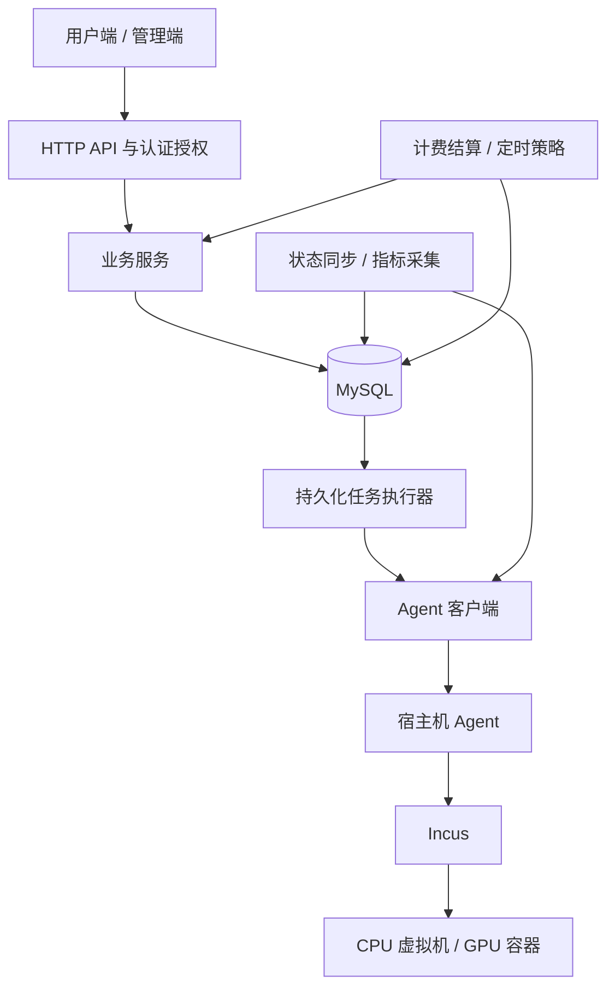

# 101cloud 后端设计方案

配套契约：[后端接口文档](后端接口文档.md)及[OpenAPI 3.1](openapi.json)。

状态：后端代码已实现，当前按单进程API与Worker运行；实际本地MySQL/HTTPS/节点协议联调范围见第14节，未部署远端节点。

## 1. 目标与边界

面向工作室成员提供 VPS 式自助管理：CPU 虚拟机、GPU 容器、规格选择、生命周期管理、局域网IP分配与直连、Web 运维、积分计费、监控与管理员管理。当前不提供NAT模式或端口映射。

基于原始backend/sql/init.sql的37表、显式后端迁移及host-agent/client实现。Agent原有硬件验收与本次后端协议验收独立；后端已经实现持续入库、汇总和保留任务，运行前须配置并绑定相应政策。

本方案不包含现金支付、退款、发票系统；不引入微服务、Redis、消息队列或 Kubernetes。实施阶段顺序不代表减少最终交付范围。

## 2. 技术选型

| 部分 | 方案 |
|---|---|
| 语言 | Go |
| HTTP | Gin |
| 数据库 | MySQL 8.4 LTS / InnoDB |
| ORM | GORM |
| 数据迁移 | 内置显式SQL迁移器，数据库锁、文件校验和及迁移日志；不使用AutoMigrate |
| 认证 | 服务端 Session + 安全 Cookie |
| 后台任务 | MySQL tasks / task_steps |
| Agent 通信 | 复用现有 Go client，Token 认证和证书指纹固定校验 |
| Web 运维 | 后端授权的 WebSocket 桥接 |
| 日志 | slog 结构化日志 |
| 接口契约 | OpenAPI |

一个Go项目、一个后端二进制，当前API与Worker同进程运行。数据库任务可恢复，运维预连接具有进程亲和性；拆分多进程前必须为控制台会话提供路由亲和，不能直接把内存中的上游流交给另一进程。

前端生产资源由 `backend/build.sh` 先构建至 `internal/webui/dist/`，使用 Go `embed` 与SQL迁移一起编入后端。Go同时提供页面、静态文件和API；SPA深链接返回index，缺失静态文件404，`/api`及其子路径保留JSON错误而不回退页面。index及运行时配置no-store，内容哈希JS/CSS可长期缓存。开发仍用Vite同源代理，部署HTTPS由Nginx反代全部路径；数据库、配置、主密钥和Host Agent独立保留。当前为代码实现，未切换线上Nginx。

## 3. 架构与职责



- 后端负责身份权限、产品规则、资源分配、积分计费、操作编排。
- Agent 负责执行与观测，不承担用户权限和计费。
- MySQL 保存业务事实、期望状态、任务、账本及历史指标。
- Incus 是实际运行状态的事实来源；数据库状态更新不等于外部操作完成。
- 浏览器不得直连 Agent；后端不得向用户提供任意 Incus API 透传。

代码采用 `Handler → Service → 数据访问 / Agent 适配器`。Handler 处理协议与参数，Service 控制权限、事务和状态转换，数据访问层集中查询。按业务能力组织模块，不建立万能泛型 CRUD 框架。

请求 DTO、数据库 Model、响应 DTO 分离，防止内部字段和秘密进入公开响应。

## 4. GORM 使用规范

1. 生产不使用 AutoMigrate。SQL 迁移是结构变更入口，保留生成列、CHECK、复合外键等精确语义。
2. 不直接嵌入 gorm.Model；显式映射现有 ID、微秒时间与删除语义。
3. 金额和费率使用精确十进制类型映射 DECIMAL，不能经过 float64。API 金额使用字符串，舍入规则统一。
4. 指标使用可空类型，严格区分零与未知。
5. 事务由业务 Service 控制；不通过 Hook 隐藏扣费、分配或 Agent 调用。
6. 行锁、领取任务、批量写入和统计允许参数化原生 SQL。
7. 更新显式指定字段，防止零值跳过、整行状态覆盖、意外关联写入。
8. 每个数据库连接使用 UTC+8（+08:00）和严格 SQL 模式，DATETIME按UTC+8存储；Go驱动的时间解析位置也须一致，不能仅设置loc而不设置会话time_zone。Agent返回的UTC时间入库前显式转换，业务周期仍使用明确配置的时区。SQL的SESSION设置只影响执行连接，不改变服务器全局配置或自动转换已有DATETIME历史值。

## 5. 业务模块

| 模块 | 职责 |
|---|---|
| 账号与权限 | 登录、会话、用户状态、角色、资源归属、配额 |
| 产品目录 | 镜像、规格、自定义规格边界、初始化模板 |
| 节点管理 | Agent 接入、健康、库存、维护、排空 |
| 实例管理 | 创建、启动、停止、重启、删除、规格变更、初始化 |
| GPU 管理 | 共享/独占分配、绑定、释放、换卡、占用确认 |
| 网络管理 | 地址池、IP预留、节点网络绑定、局域网直连与地址冲突检查 |
| 积分与计费 | 每日额度、兑换、预留、结算、账单、账本 |
| 自定义实例与策略 | 管理员直接下发、资源预算、GPU空闲与均衡策略 |
| 监控 | 当前指标、增量入库、历史曲线、汇总、保留策略 |
| 任务与审计 | 异步操作、步骤恢复、幂等、操作记录 |
| Web 运维 | 容器终端、虚拟机控制台及授权生命周期 |

### 5.1 已确认的两类实例

| 项目 | 弹性实例 | 管理员下发的自定义实例 |
|---|---|---|
| 创建入口 | 用户选择或选配平台允许的规格 | 申请和沟通在平台外完成，平台仅管理员直接下发 |
| 配置范围 | 平台发布的规格及可配置范围 | 不受套餐限制，自由指定 CPU、内存、磁盘、镜像、GPU 和网络需求 |
| 每日额度 | 使用每日额度，耗尽进入关机宽限期 | 不受每日额度限制，不因用户额度耗尽而关机 |
| GPU 调整 | 容器可请求热添加、移除和换卡，受权限、兼容性及资源准入约束 | 由管理员下发的配置与策略决定，不因豁免而绕过硬件安全限制 |
| 审计与容量 | 记录分配、运行、费用与操作 | 同样记录实际占用和操作，按 admin_exempt 记录豁免 |

“完全自定义”是业务规格自由，不是无限资源、任意宿主机权限或硬件能力无限制。管理员下发仍必须满足节点容量、虚拟化能力、GPU兼容性和地址冲突检查。普通用户不能通过提交 billing_mode 或实例类型字段自行获得豁免。

平台不提供自定义实例申请、撤销、审核、批准或拒绝流程，也不保存申请或审核记录。管理员通过POST /admin/custom-instances直接创建持久化交付任务，或通过已有实例纳管入口接管；approved_config仅为保留的对外配置字段名。实例不绑定虚假套餐，仍执行资源配额、max_resident_instances、容量、GPU、网络和初始化模板检查。

管理员自定义创建的顶层只写 `login` 与成员最终创建共用 `LoginRequest`、`normalizeLogin` 和 `admitCreate`；不进入 `approved_config`、Spec、初始化参数、任务或普通快照。省略 login 保留原网络路径；提供密码或公钥时依赖精确节点/项目 ready 镜像的 cloud_init 能力，复用加密存储、首次启动准备与只读就绪检查。模板仍独立执行，不重写登录/网络 user-data；导入拒绝 login，既有实例凭据不变。保持 admin_exempt、资源/常驻配额、权限和政策冻结；幂等仅保存带密钥的请求摘要和安全响应，相同 key/body 重放，变更 body 冲突。本次接入仅本地实现，未部署。

GPU空闲策略与每日额度豁免是独立维度：自定义实例不会被额度任务关闭，但可以在管理员授权范围内由用户主动启用GPU空闲策略。

### 5.2 套餐节点与实例授权快照

Plan输入/输出新增`node_ids`、`gpu_policy`、`allowed_user_actions`、`gpu_user_permissions`。node_ids是显式、非空且不重复的多节点允许列表；所有选中网络绑定必须属于这些节点，每个节点至少有一个兼容网络。草稿要求每个选中镜像在每个节点/网络项目存在配置、架构匹配；提供GPU型号时各配置须gpu_ready。发布还要求节点已验证、active/online，网络已验证可用，镜像active且节点项目配置ready。网络绑定仍唯一确定实例节点；报价/创建可带可选node_id作一致性断言，必须等于该网络节点且属于套餐，不引入自动放置或实例迁移。

gpu_policy复用实例GPU策略形状：idle包含enabled/timeout_seconds/action（detach_gpu或stop_instance），rebalance包含enabled/allow_live/max_hourly_pt。超时/动作及启用条件受套餐绑定gpu-idle政策限制；gpu.max_hourly_pt与rebalance.max_hourly_pt必须数值相等，使用非负DECIMAL(20,6)字符串。报价/创建即使count=0也不能提交超出套餐的价格上限。VM不得启用GPU空闲、均衡或在线迁移、不得提供GPU动作或true的GPU编辑权限。容器初始0卡不等于永久禁用GPU：套餐型号及gpu_count选配、实例授权与资源准入仍可允许之后挂卡。

新套餐省略策略时空闲/均衡/在线迁移默认关闭、超时/动作取绑定政策默认；allowed_user_actions省略默认为start/stop/restart/console，gpu_user_permissions省略默认为{}。显式[]/{}保留。套餐创建disabled，任意数量可独立active。任何状态可PATCH全部字段（含code/version，组合唯一；不含status），省略保留；active编辑完整校验已发布引用和就绪放置，失败事务回滚。POST /admin/plans/{id}/enable与/disable要求If-Match及Idempotency-Key，仅修改目标，不再提供套餐publish/retire。报价返回plan_revision，创建必须原样提交，否则409 plan_changed且无副作用。elastic创建及迁移冻结plan_snapshot={revision:字符串,vcpus:整数,memory_bytes:字符串,disk_bytes:字符串,allowed_overrides:对象}；custom为null，resize使用冻结边界而非可变套餐，既有实例不随编辑变化。模板、政策仍使用原发布生命周期。

Instance DTO公开plan_snapshot（custom为null）；resize请求不再接受policy_versions，沿用实例冻结价格/政策和snapshot边界，不从当前套餐重新报价或替换政策。

弹性实例准入复制套餐GPU策略、动作及六项权限到实例，而非运行时关联当前套餐授权；其中rebalance.max_hourly_pt使用准入请求的gpu.max_hourly_pt并与实例唯一GPU上限一致，可低于套餐上限。后续套餐新版本不回写既有实例。全部非管理员elastic/custom实例的start/stop/restart/resize/delete、GPU挂载/移除/换卡、gpu_policy及console均检查实例动作允许列表，只有管理员绕过该列表，但仍受状态、配额、硬件安全和确认约束；显示名修改不是此列表动作。capabilities按同一授权裁剪，不能替代服务端检查。

GPU策略读取返回allowed_ranges.editable：非管理员必须同时有gpu_policy动作及对应gpu_user_permissions才可编辑。六项idle/idle_timeout/idle_action/rebalance/allow_live/max_hourly_pt分别控制idle.enabled/timeout_seconds/action、rebalance.enabled/allow_live/max_hourly_pt，缺失键为false。PUT完整配置，对实际改变的字段逐项授权；未授权但不变字段可原样回传。管理员可通过实例GPU策略接口替换实例动作及权限，不影响套餐或其他实例；平台有效策略和安全证据不因权限放宽而失效。


## 6. 实例操作与持久化任务

### 6.1 创建流程

1. 验证身份、规格、配额和节点资格。
2. 在固定锁顺序的短事务中检查并预留容量、GPU 名额、IP、积分，创建实例记录和任务。
3. 提交事务，返回 HTTP 202、task_id、instance_id。
4. Worker 领取任务，通过 Agent 创建实例。
5. 保存 Incus operation ID，等待并核对实际结果。
6. 执行初始化、确认状态并建立正确的计费区间。
7. 前端查询任务进度和实例状态。

事务内不得等待 Agent HTTP 请求。失败补偿同样必须可恢复，不能仅依赖内存清理逻辑。

### 6.2 幂等与恢复

现有 tasks/task_steps 已包含幂等键、租约、阶段、operation ID 和同实例活跃变更约束。

- 同一幂等键及相同请求返回原任务；同键不同请求返回冲突。
- 后端重启后从数据库恢复任务。
- Agent 超时不代表失败；先查询已有操作和实际资源，不能盲目重新创建。
- unknown、回收中、执行中的资源继续占用预算。
- 租约过期不证明旧执行器停止；接管前核对外部操作，防止并发变更。
- 不宣称数据库事务能让外部操作恰好执行一次；依靠步骤持久化、幂等标识和状态核对。

### 6.3 调整规格与显式删除

resize 请求可包含 `confirm_restart`，运行中必须显式为 true；所有非管理员elastic/custom实例均须具有resize权限，运行中还须stop/start权限。已停止实例调整后仍保持停止。运行中在单个后端持久化任务保存 `restart_after_resize:true`、`previous_resources` 和期望 running，按 `state.stop → resize.native → resize.confirmed → state.start` 正常停止并确认、修改配置并确认、再启动；不得用强停替代正常关机，也不得让客户端串联请求。恢复依赖持久化阶段与外部操作核对；一旦写入启动意图，不再重放更早的停机或配置步骤。套餐限制、用户配额、节点容量、custom 常驻预算、resize-limits 以及磁盘禁止缩容均保持生效。

删除始终要求精确实例名 `confirm_name` 和 `delete_data:true`。运行中删除仅限管理员，另要求 `mode:"force"`、`confirm_data_loss_risk:true`，说明未保存数据丢失风险。单个后端持久化任务保存 force=true，先强制停止并确认，之后才向 Agent 发 DELETE；确认删除后还须获取新鲜 GPU 实际占用证据才释放分配，不能复用停止前证据。普通用户删除必须已停止。客户端只提交删除并查询任务，不编排 stop/delete；超时、断线或未知保留资源占用，通过已记录操作和实际状态恢复，不把不确定结果当成功或盲目重放破坏性阶段。

管理员显式 `cleanup_stuck:true` 是独立的故障清理语义（DELETE /admin/instances/{id} 或 POST /admin/instances/{id}/delete），仍必须 force、风险、精确名称、销毁数据全部确认。它不要求 ready、新鲜观测或空闲任务槽：在既有财务账户/实例锁之后锁定所有活动实例任务，取消并递增租约代数，关闭活动步骤但保留原 operation_id，然后在同一事务提交新的 instance.delete 任务；已有活动清理直接复用。原记录保留，任务与账本不级联删除。

仅取消 SQL 行不足以阻止迟到 CREATE/START。所有 worker 原生变更（创建、启动/停止/重启、resize、GPU、初始化 exec）在最终 HTTP 边界锁定并核实 task 行的状态/租约代数/有效期。持锁期间先用独立提交写 native_dispatch_started，再发请求，并在释放 task 锁前写返回的 operation_id；接管同样取得 task 行锁，故不能越过正在派发但尚未写编号的请求。新步骤标记 native_dispatch_fenced，尚未派发即可安全撤销。持久化的已开始标记无编号代表崩溃/传输歧义，不能由空实例列表掩盖；旧版歧义 journal 同样保守处理。

清理先核实已存在目标的 UUID/归属，再核对全部历史 operation_id 和批准项目的活动 Incus 操作。可取消操作先取消，但必须等待/再读到终态；不可取消或不确定时保留资源。UUID 缺失必须有 user.101cloud.instance_id，冲突标记禁止清理别的原生实例。完整项目实例枚举不含目标（名称、UUID、归属标记均缺席），或目标 GET 的 HTTP404 与 Incus error404 一致，才确认目标不存在；离线/403/超时不表示消失。初始已不存在时跳过 stop/delete，成功清理不要求历史删除意图，也不读取主机级 GPU 指标。普通删除原有严格 GPU 回收校验不变。

最终在账户锁与当前任务租约下关闭用量与预留、释放 IP/GPU、写 deleted_at 墓碑，仅执行一次，历史消费不退还、积分不重发；保留原生名称唯一约束以防名称重用竞态。失败创建自动回收不再接管显式强制清理，迟到任务不能修改墓碑/退还历史消费。无法确认原生提交编号时公开 cleanup_native_submission_unknown 与恢复指引；管理员从可信原生日志恢复 task_steps.operation_id 后协调当前清理任务，而非重放旧创建/启动。此安全边界不能用租约超时或某次空列表冒充端到端恰好一次。


## 7. 资源与网络调度

采用明确准入规则，不建设复杂调度平台：

- CPU 虚拟机不分配 GPU；GPU 容器先按型号、价格和共享/独占规则筛选，再在可分配候选中选择负载最低的卡，详见第7.2节。
- 节点必须在线、允许分配，库存不能过期。
- CPU 超分比例可配置，内存默认不超分；预留宿主机及系统服务容量。
- 停机磁盘仍占存储预算；创建中、释放中、未知资源仍计入占用。
- 实际磁盘余量等观测作为额外保护，不能替代业务预留账。
- GPU 分配依据分配记录、共享名额及实际绑定，不能依据利用率为零。
- 共享名额不是显存隔离或算力保证，产品必须明确共享限制。
- IP 来自管理员配置的地址池；无响应的地址不自动成为可分配资源。地址池名称全局唯一，同地址族子网不得重叠。
- 实例所在节点由所选网络选项（节点网络绑定）决定；管理员直接下发自定义实例时必须明确node_id，网络选项须属于该节点。
- 网络仅规划管理员批准的局域网直连模式，不提供NAT、端口映射或自动配置上游路由器。

### 7.1 网络模式范围

使用管理员批准的现有bridge或适用容器的macvlan连接局域网，为实例分配独立IP。虚拟机优先使用bridge；macvlan存在宿主机与实例直接通信限制，不能当成通用桥接替代。若使用Incus托管bridge，必须明确关闭NAT且具备所需局域网接入或路由条件，不能隐含创建隔离NAT网络。

保留地址池、网关、DNS、IP预留/释放、冲突探测及节点接口绑定；不规划端口映射页面、API、任务和公网端口库存。删除NAT产品能力不意味着修改现有节点网络或删除现存转发规则，本次仅调整设计文档。

### 7.2 GPU绑定时选择最低负载卡

已确认：最低负载选卡不仅用于后续自动均衡，也用于首次创建GPU容器、给运行容器热添加GPU、用户重新申请已释放的GPU，以及已获授权的自动恢复绑定。已有正常绑定不因普通状态同步而重新选卡；运行中换卡仍遵守第9.2节的安全条件。

1. 在实例所在节点筛选健康、允许分配且指标新鲜的GPU，满足型号/能力、显存需求、共享或独占名额、价格上限及用户额度。新建实例先确定符合容量要求的节点，再逐卡选择；不是跨节点迁移实例。
2. 默认负载分数使用逐卡SM利用率与显存占用率的等权综合值：0.5 × SM利用率 + 0.5 × 显存占用率，与Agent当前资源接口口径一致。后端可配置权重，权重非负且和为1；评分基于有效观测，不使用节点平均负载。
3. 在通过硬性准入的候选中按分数从低到高选择；同分时先选有效分配及预留数较少的卡，再以UUID稳定排序。负载未知或过期的卡不按0分参与自动选择；无可用候选时返回明确原因，不越过安全条件强行绑定。
4. 选择后在短事务中锁定并复验节点/GPU容量、分配和预留，原子预留目标名额；并发请求不能只依赖同一份低负载快照而超卖。已预留但未产生负载的任务仍占用名额，后续请求重新评估候选。
5. 多卡请求选取不同UUID，逐项计入预留，不重复选择同一卡。通过Agent绑定后核对实际配置；超时或未知保留预留并继续核对，不立即释放后再次分配。

最低负载指决策时有效观测下、满足准入条件的候选最低分，不保证执行完成时仍然最低，也不保证共享GPU显存隔离。管理员指定固定UUID属于显式人工覆盖，仍需通过准入与审计；普通自动绑定遵守上述规则。

选卡策略、权重、指标有效期及允许型号/价格范围由后端版本化配置管理。首次绑定与自动均衡复用同一候选过滤及评分逻辑；均衡额外要求源容器安全空闲、改善幅度和冷却条件。

## 8. 积分与计费

沿用 credit_buckets、credit_reservations、usage_sessions、usage_charges、credit_ledger。计费按配置及资源使用权持有时间，不依据 CPU/GPU 利用率。

### 8.1 每日定时额度

已确认：后端每天在配置的时间，给符合条件的用户发放配置数量的额度。金额、周期时区、发放时间、适用用户范围均可配置，不把历史讨论中的示例额度写死。

- 按账号和业务日期建立唯一发放键，同一周期只发一次；任务重跑、进程重启不能重复发放。
- 当前库的 daily bucket 要求有效期；每日额度是否结转、过期方式须作为显式政策。定时发放不等于已确认“余额直接重置为某固定值”。
- 发放失败恢复后按原业务周期补处理，不能把已经过期的历史额度重新变成可用新额度。
- 兑换或管理员额度与每日额度分桶记账，若参与支付，明确消费顺序与有效期。

### 8.2 额度耗尽：通知、十分钟宽限、强制关机

已确认默认规则：用户额度耗尽，立即提示保存数据并自行关机；耗尽超过10分钟仍未关闭的弹性实例，后端强制关闭，**不删除实例和磁盘数据**。宽限时长属于后端可配置政策，当前确定值为600秒。

1. 结算器确认可支付额度耗尽，保存耗尽事件、exhausted_at、shutdown_deadline、受影响实例和所用策略版本。不能把“积分已预留、可用余额为0”误判为实际耗尽；还需核对预留覆盖的运行区间。
2. 向用户发送持久化站内通知，在线页面显示保存数据提示和倒计时。用户不在线或通知推送失败不能令关机任务永久失效；可选邮件等渠道另行配置，不声称当前已有通知系统。
3. 宽限期允许保存数据、查看状态、使用终端和自行关机；默认阻止新的收费创建、启动、扩容和GPU增配。重复轮询或重启不能重置倒计时。
4. 截止时间到达后，在同实例串行任务中重新核对额度事件、实例类型与运行状态。仍符合条件则通过Agent调用Incus强制stop，并核验操作终态及实际Stopped状态；不得调用删除或清理卷接口。
5. 已自行关机的实例不重复停止；自定义豁免实例不在影响范围。账号有多个弹性实例时，默认一起进入该账号的额度耗尽处理范围，不能随机只停其中一个。
6. 节点失联时记录关机待执行/结果未知并告警，恢复后重新核对再执行；不能承诺网络不可达时在第600秒准确停机，也不能虚报已关机。

强制关机只能保证平台不主动删除已保存的磁盘数据，不能保证未保存内存数据或应用在途写入不丢失；提示中必须说明该风险。确认关机后全部资源停止计费，但磁盘仍占存储预算，GPU默认保留绑定并继续占用容量；只有明确移除且确认实际回收后才释放名额。

建议默认政策，尚待最终确认：宽限期间作为平台承担的救济运行区间，仍记使用量但不制造负余额；每日发放或兑换使额度重新足以支付后，撤销尚未执行的额度关机任务。执行前需在事务中校验事件代次，不能让旧截止任务关闭已恢复额度的实例。已关机实例不自动启动，避免未经用户确认重新消耗额度。

### 8.3 收费口径与账本不变量

| 资源 | 收费口径 |
|---|---|
| CPU、内存 | 弹性实例运行期间按配置收费，确认停止后免费 |
| 磁盘 | storage_charge_mode仅支持running_only（仅运行时收费）或free（始终免费）；停机仍保留数据与容量，额度耗尽不得自动删盘 |
| GPU | 运行时按有效分配收费；确认停止后免费但保留绑定和容量，再次确认运行后恢复计费；停止不等于已释放 |
| 管理员自定义实例 | admin_exempt，不扣每日额度，记录资源使用与基本操作审计，不收集管理员操作原因 |

- 可复用价格配置档可编辑，但实例费率及历史快照不改写。用户钱包credit政策管理共享每日额度；实例冻结credit绑定管理各自宽限/停机/存储，选择套餐不覆盖钱包、不按实例增发。套餐、实例、节点监控、账户或历史引用阻止删除；变更规格关闭旧区间。确认停止时关闭CPU、内存、磁盘、GPU收费区间，再次确认运行时恢复所有应计费区间。停机前费用保留，不自动追溯退款；未交付创建失败退款规则保持。
- 预留、结算、账本写入在一致的短事务中完成。
- 统一精度及舍入，避免因结算分段次数不同产生不同总费用。
- 节点失联不能释放未知资源，也不能伪造停止时间；offline_charge_mode只决定尚未确认停止的离线区间如何收费，不覆盖确认停止后全部资源免费规则。停止请求失败或结果未知不能提前免计费。
- 账本和审计只追加，不以覆盖历史修正余额。

### 8.4 历史欠费异步分批抵扣

- `20261103_10_async_credit_settlement.sql` 增加 `credit_accounts.settlement_pending` 和按账户/状态/id取费用的索引；升级时仅为有效未预留额度或原会话held额度可支付的历史欠费回填标记。账户本身就是持久化队列，不依赖进程内channel或可能超时未知的外部任务租约。
- 管理员正数调整HTTP只提交真实桶、流水、审计、幂等快照和待处理标记；不调用restore，不逐笔修改历史费用。201中的`settled_debt_pt="0.000000"`，gross欠费仍是提交时值；净remaining=有效内部余额减gross欠费，available再减reserved，保证发放立即改善净余额且不能被误读为清偿。
- 每秒后台轮询持久化标记，每账户每事务最多选择32笔欠费、最多32个有效未预留桶和32笔held来源；每批提交后释放账户锁，再由后续轮询继续。失败回滚与进程重启都保留可恢复标记；账本、费用金额/状态和标记同事务推进，重复轮询不得重复支付。没有当前可支付资金时标记清除，后续发放重新排队；周期结算器也重新发现未来生效资金。
- 日额度补发每账户事务最多32个业务日，过期处理每次32桶；周期结算逐活动会话单独提交，再执行一个有界历史批次。停机执行门和enforcement轮询只依据净资金判断恢复，不替管理员同步遍历偿债。
- 不额外建立或延长欠费资金预留。worker支付时重新检查有效期；短期限未预留额度可能在抵扣前到期，不能将其静默变成永久资金。已有held来源即使桶到期仍只归原会话，后续计费或释放不能挪给其他会话；ended会话清偿后的残余held由有界维护批次释放。
- 创建、启动、扩容、GPU准入/预留和负数调整均在账户锁下扣除gross欠费后校验；新使用费用只能支付超过更早欠费的未预留余额，且不能抢占同会话较早欠费拥有的held来源。使用精确十进制和逐费用流水，不豁免旧债，不伪造余额。
- MySQL回归使用完整前向迁移和真实HTTP事务：6001笔欠费发放零同步费用改写、32笔批次、第二次发放穿插批次、并发请求/worker分离、新App恢复、失败回滚、幂等原快照和逐笔资金守恒；到期/未来资金、held归属及拒绝新消费的事务回滚另有覆盖。

## 9. 正式指标采集

持续采集 Worker 替代临时验收任务，网页请求不负责触发入库。

- 按节点拉取 Agent 增量样本。
- 通过节点与实例 UUID 匹配业务实例，不只匹配名称。
- 原始样本写入与游标推进在同一事务完成。
- Agent 重启识别为新采集流；历史被覆盖时记录缺口，不补零。
- 分指标保留 NULL 和质量，不能因 GPU 部分未知抹掉有效 CPU/内存数据。
- 已确认的 GPU 进程数、显存可以有值，同时引用完整性仍为 false；这不允许自动释放。
- 汇总裁剪桶边界、按有效时间加权，覆盖区间去重，不计算平均值的平均值。
- CPU 使用自身计数观测窗口，跨重启或计数器重置不拼接差值。
- 原始数据与汇总的粒度、保留周期分别配置，清理遵循外键依赖。

接口分为当前状态和历史曲线：前者包含采样时间、过期标记、质量原因；后者包含时间范围、粒度、有效覆盖与缺测。

自动释放需要新鲜观测、完整占用证据和串行变更流程，不能拿历史 idle_candidate 当操作授权。

### 9.1 用户启用GPU空闲超时策略

已确认：用户可以为容器启用GPU空闲超时，指定空闲多少分钟，以及执行“移除GPU”或“关机”。功能开关、默认值、允许范围和动作权限由后端管理员配置，用户在允许范围内保存实例级设置。默认不替用户开启破坏性自动动作。

- 空闲依据目标容器在目标卡上的占用，不以整卡利用率代替容器指标，也不强制要求容器CPU空闲。
- 对自动移除/换卡，必须没有GPU进程、显存占用或设备引用，并且归属证据完整新鲜；GPU空闲政策不设置利用率或显存百分比，已知非零SM采样不能累计空闲。进程存在但暂时0%仍不是可安全移除状态。整卡指标展示与GPU调度高低负载阈值保留。
- 按连续有效采样时间累计空闲时长；出现负载、采集缺口、过期、未知或实例运行代次变化时重置连续窗口。反复读取同一采样不能累计时长。
- 多卡容器的“移除”针对达到条件的卡，保留其他卡；“关机”要求其全部配置卡及实际观察到的旧卡均满足连续空闲条件，避免停止另一张卡上的任务。
- 移除动作使用Agent的GPU配置接口，保留容器、CPU任务和磁盘；只有确认旧卡实际不再占用后才释放名额。CPU应用若稍后调用GPU可能失败，必须在用户开启策略时说明。
- 关机是用户明确授权的独立动作，保留磁盘，默认先正常stop。空闲策略不自动继承额度耗尽的强制关机权限；是否允许正常关机超时后强停需单独配置授权。
- GPU移除后不会因为仍配置了“期望GPU数量”而立即被同步器重新挂回；需要保存主动释放状态。自动恢复须单独启用并定义触发条件，当前未将其视为已确认业务规则。

### 9.2 节点逐卡轮询与在线负载均衡

已确认目标：后端周期性轮询节点每张卡的负载；当某容器没有GPU占用，而绑定卡整体负载高时，尝试在线切换到同节点负载较低的兼容GPU。这里只改变容器GPU绑定，不迁移容器到其他节点，也不迁移正在运行的CUDA任务。

数据来源：`GET /agent/v1/resources`取得逐卡利用率、显存和库存；`GET /agent/v1/instances/metrics`取得容器级占用和质量；历史采集使用增量接口。后端按节点有界并发轮询，频率、超时、观测有效期可配置。Agent自身采样频率另受其配置约束，增加HTTP轮询次数不等于产生更多独立样本。

选择及执行流程：

1. 开启平台及实例的自动均衡策略，实例不处于额度耗尽、停止、删除、换卡或其他变更任务中。
2. 源卡在配置窗口内持续高负载；目标容器在该卡持续满足安全空闲条件。源卡忙可能来自其他容器，不能把整卡忙误判为此容器忙。
3. 目标卡必须同节点、兼容型号/能力、显存满足需求、健康可用、共享/独占规则及预留名额允许，并满足实例GPU价格上限。默认不自动升价；允许跨价格切换时须经明确授权并切分价格区间。
4. 使用逐卡利用率、显存压力和预留占用选择候选，不只使用节点平均分。高低阈值、最小改善幅度、持续窗口、冷却时间、每节点并发及迁移次数上限可配置，避免反复来回切换。
5. 在短事务中预留目标卡，锁定实例变更和相关GPU分配，记录源/目标UUID与任务代次；调用Agent前重新核对配置和新鲜占用。
6. 通过GPU接口提交完整期望UUID列表和allow_live=true，等待操作并重新读取配置。保留不参与切换的其他GPU。
7. 复核旧卡残留及新卡可见性。配置更新成功不等于业务程序已使用新卡，也不等于旧卡已释放；旧名额保留至回收证据充分。
8. 失败或未知时停止进一步均衡，保留可能占用的源/目标名额，进行状态核对。不得盲目再次分卡、强杀用户进程、整卡reset或为完成均衡擅自关机。

重要边界：现有接口是设备热调整，不是原子安全迁移。CUDA上下文、显存、库内部缓存不会迁移，长期运行程序可能必须自行重新初始化GPU或重启应用才能使用新卡。观测与设备修改之间也可能新启动GPU任务；ETag只能保护部分配置并发，不能锁住用户进程。

因此当前可以实现“符合安全观测条件时的尽力在线重绑定”，不能宣称任意工作负载无感切换或零竞态。若产品要求绝对保证切换期间无新GPU任务，必须另行设计应用协作的暂停提交/确认协议，或具备明确语义的设备访问门控能力；当前Agent没有该保证。该限制不以忽略质量或强制清理旧任务来掩盖。

### 9.3 后端配置与策略优先级

策略为有类型和范围校验的可复用配置档，无全局默认绑定。套餐及custom创建/导入显式绑定pricing/credit/metrics，容器另需gpu-idle/gpu-scheduling，支持GPU的容器套餐及启用GPU的custom容器另需gpu-pricing。实例准入冻结ID，后续启动/GPU/空闲/均衡/计费不跟随当前套餐。节点采集使用nodes.metrics_policy_id，实例查询使用冻结metrics。节点GPU不绑定价格，同型号可由不同套餐定价，历史分配不重定价。用户只能修改授权策略；混合实例credit政策产生独立耗尽事件，账户enforcements数组表示全部事件，已捕获期限不变。

缺少GPU价格且完全没有GPU分配历史的legacy custom实例，允许管理员以`PUT /admin/instances/{id}/gpu-pricing-policy {policy_version_id}`一次性显式补齐active/已生效gpu-pricing绑定，须CSRF、Idempotency-Key和If-Match，返回policy_versions、revision及新ETag。已有绑定、elastic实例或任何历史分配均409 policy_binding_frozen；后续仍冻结该绑定，绝不改写历史价格或分配。

| 类别 | 可配置项 |
|---|---|
| 额度 | 每日数量、发放时间/时区、有效期、结算周期、耗尽宽限（当前600秒）、通知渠道 |
| 自定义实例 | 管理员下发配置、所有者、豁免模式、可用GPU策略 |
| 空闲 | 平台/实例开关、空闲分钟数、阈值、有效采样要求、移除或关机、正常关机超时及强停权限 |
| 均衡 | 轮询周期、持续高负载窗口、目标低负载阈值、最小改善幅度、冷却、并发上限、允许型号和价格范围 |
| 安全 | 指标新鲜度、缺测处理、失败后核对期限、管理员接管 |

“可配置”不允许把未知当空闲、跳过资源预留、越权获得豁免或把配置更新等同资源回收。策略冲突采用：用户/管理员停止删除及额度停机优先，其次空闲动作，最后负载均衡；均通过同实例变更队列串行。已经进入额度宽限的实例不再自动换卡或增配。

### 9.4 当前可行性与证据范围

| 需求 | 当前基础 | 结论与待实现内容 |
|---|---|---|
| 每日发额度 | credit_policy_versions及额度桶、账本已有DDL | 可实现；定时发放、幂等补做、结算服务尚未实现 |
| 耗尽提示、10分钟后强停不删盘 | Agent透传Incus stop/force，任务表已有恢复基础 | 可实现；需通知、持久化截止事件、撤销与核对流程；失联期间不能保证准点执行 |
| 管理员自定义下发并豁免 | 实例自定义资源字段和admin_exempt已存在 | 管理员直接下发与已有实例纳管，不提供平台内申请审批 |
| 容器GPU热插拔 | GPU接口支持UUID列表及allow_live，空列表移除 | 有接口基础；受容器、驱动、应用及Agent管理设备范围限制，不覆盖CPU虚拟机GPU透传 |
| GPU空闲移除或关机 | 容器级占用、质量、空闲策略表已有基础 | 可实现；需用户设置、连续有效窗口、策略任务和动作复核 |
| 逐卡轮询及在线均衡 | 逐卡资源接口与容器指标可组合使用 | 可实现有条件的在线重绑定；当前不具备无感上下文迁移或原子安全切换保证 |

依据：[Agent GPU配置契约](../host-agent/docs/AGENT使用指南.md#53-put-agentv1instancesnamegpuprojectdefault)、该指南第5.2/5.5节资源和指标、第6.2节启停，以及[现有DDL](sql/init.sql)。真实验收已覆盖单卡负载归属和忙闲转换，但本次没有执行新的运行测试，不能把它等同于多卡自动均衡或额度关机端到端验收。这些是后端设计和能力核查，不表示对应业务服务已经部署。

## 10. 安全与接入边界

- 每次实例、任务、指标、终端请求检查资源归属；管理员也走一致业务流程和审计。
- Session Cookie 使用 HttpOnly、SameSite=Lax；https origin 下为 Secure 的 `__Host-` Cookie，仅本地开发的 http origin 使用无前缀、非 Secure Cookie；写操作进行 CSRF 防护。
- 节点 Token 加密存储，主密钥置于数据库外；校验固定证书指纹。
- WebSocket 校验会话、Origin、实例权限，不向浏览器暴露节点 Token 或 operation secret。
- 初始化使用管理员发布的模板版本，用户仅填写允许参数。
- 常规日志、任务和审计脱敏，不保存终端正文、口令、私钥及秘密参数。唯一明确例外是首次serve成功创建管理员后输出一次随机初始账号密码；该启动日志必须按秘密保护，登录后应修改密码。
- 接入节点默认只读发现，不自动修改网卡、路由、防火墙、AppArmor、驱动或 systemd。
- 已有实例先标记未纳管，由管理员显式导入；不能因发现实例就收费、停止或回收。

## 11. 数据库契约审查

以下契约通过20261030系列SQL迁移和相应业务模块实现；经济政策未知部分仍要求管理员显式配置，不生成默认价格或额度：

1. 请求内容摘要：识别相同幂等键但不同请求。
2. Worker 领取代次或版本检查：防止旧执行器覆盖新结果。
3. 汇总处理进度和采集缺口的持久化表达。
4. 节点管理状态与健康状态分离：失联不应覆盖维护设置。
5. 初始化秘密参数的安全传递、存储边界和任务恢复。
6. 管理员、价格、策略、规格的首次引导顺序，避免循环依赖。
7. 自定义实例由管理员直接下发，instances.instance_plan_id允许为空，不创建虚假套餐；20261030_80_retire_custom_requests.sql删除custom_instance_requests、residency_requests和instances.custom_reason。旧init.sql及历史迁移不可修改，首次安装和升级均顺序执行前向迁移；保留实例、任务、用户及通用审计历史。
8. 持久化额度耗尽事件、事件代次、通知和投递状态、600秒截止时间、受影响实例、撤销原因；任务重启不得重置截止时间。
9. 区分实例产品类型、额度豁免、GPU空闲开关、自动均衡开关与自动恢复开关。现有auto_release_gpu/auto_rebind_gpu不能含混承担所有语义。
10. 扩展策略版本，表达用户空闲分钟数、均衡阈值/窗口/冷却/价格边界，以及空闲累计和上次换卡时间；现有idle_policy_versions没有完整的负载均衡参数。
11. 源/目标卡双边预留、释放确认、失败核对及切换收费边界。安全上保留双边名额不等于默认向用户双重收费，自动均衡过渡费用承担需明确。
12. NAT退役：20261030_60_retire_nat.sql仅在旧port_forwards为空时删除旧转发表与max_port_forwards配额。存在历史记录时迁移前置检查明确拒绝，须由操作者另行归档；不会修改节点实际转发、网卡或防火墙。

套餐配置的前向迁移为`20261102_10_plan_configuration.sql`：新增plan_nodes，按既有plan_network_options对应网络节点去重回填；instance_plans新增非空gpu_policy/allowed_user_actions/gpu_user_permissions JSON列及形状约束。旧套餐GPU策略空闲/均衡/在线迁移关闭、保留价格上限；容器回填旧全动作及六项true权限，VM只回填非GPU动作、空权限映射，区别于新套餐安全默认值。既有elastic实例只补SQL NULL/JSON null的对应JSON字段，兼容旧完整动作/六项true权限，缺失策略补关闭策略及既有价格上限；显式[]/{}、已启用或其他非null策略/授权不覆盖，不从当前套餐重抄，不修改实例节点、运行状态或资源。沿用原init.sql和旧迁移校验和，按序执行新迁移；这些是迁移语义，不表示已经升级、部署或完成验收。

迁移命令只在明确配置的数据库执行。原有财务政策或账户已包含数据但尚无后端政策映射时，升级在任何后端DDL前拒绝，要求先完成明确的政策数据迁移；不猜测原账户的宽限、存储、离线等经济规则。空业务库和已完成当前迁移的数据库支持正常初始化及重复检查。

## 12. 实施顺序与验收

| 阶段 | 交付 | 验收重点 |
|---|---|---|
| 1 基础与只读接入 | 配置、迁移、管理员初始化、登录权限、节点接入、库存与状态 | 不改变原实例与宿主配置 |
| 2 任务与生命周期 | 持久化任务、规格、资源预留、最低负载GPU选卡、创建/启停/删除、初始化、局域网IP直连 | 重试和重启不重复创建、不重复分配，并发选卡不超卖 |
| 3 正式计费闭环 | 额度、预留结算、兑换、账本、余额不足处理 | 并发和跨日不重复扣费，故障可恢复 |
| 4 监控与Web运维 | 持续入库、历史曲线、汇总保留、终端与控制台 | 缺测不补零、访问不越权 |
| 5 策略与自定义交付 | 管理员自定义直接下发、GPU空闲移除或关机、逐卡轮询及有条件在线均衡、节点排空 | 不受每日额度误停，不确定状态不误回收，均衡不破坏旧任务 |

第二阶段可在管理员豁免的受控验收环境验证生命周期；向普通成员开放计费创建前，第三阶段必须完成。各阶段都需要真实链路验收，不能仅以编译或模拟测试通过作为完成标准。

新增必验场景：每日发放重复执行；耗尽前已有预留；600秒事件跨重启；宽限内自行关机/恢复额度/修改政策；一账号多个弹性实例与豁免实例共存；强停后磁盘仍在；失联后恢复执行；空闲期间采集缺口与0%但有CUDA上下文；多卡部分忙碌；源卡被别的容器压满；目标卡并发预留；换卡时新任务启动、旧卡残留、操作超时及冷却防抖。自动均衡须在至少两张兼容GPU的真实环境验收，不能仅用单卡负载成功替代。

选卡与网络验收补充：首次绑定选中合格候选最低分卡；最低分卡名额耗尽/型号不符/价格超限时选下一合格卡；未知及过期指标不当零负载；同分稳定选择、多卡UUID不重复、并发预留不超卖；网络交付使用独立局域网IP，不隐式启用NAT或创建端口映射。

## 13. 已确认规则与剩余政策决策

已确认：每日定时发放配置额度；弹性实例按允许规格选配并支持有条件GPU热插拔；额度耗尽提示保存数据，10分钟后仍未关闭则强停且不删盘；自定义实例只有管理员下发，不受每日额度限制；用户可启用GPU空闲超时移除或关机；后端逐卡轮询，支持有条件在线均衡；这些规则由后端配置管理。

仍需确定的参数或边界，不应重新视为整体需求未定：

1. GPU默认共享/独占、各卡共享名额，以及允许在线换卡的型号和应用范围。
2. 每日发放数量、时间、时区、结转/过期规则，兑换额度的消费顺序。
3. 停机后的GPU保留和全部资源免费规则已确认：不自动解绑或释放容量，再次确认运行后恢复应计费资源；保留数据，不能因余额为0自动删除。
4. 宽限期费用承担、额度恢复时是否按建议撤销待执行关机；默认不自动重启已停止实例。
5. 节点失联的不确定运行区间及自动换卡过渡期费用处理。
6. 空闲策略正常关机超时后是否允许强停，以及自动恢复GPU的独立触发条件。

其中10分钟宽限是当前确定政策，通过配置表达而不是遗留为待决定。安全与权限不变量不因管理员调整阈值而取消。

## 14. 实现、运行与验证

### 14.1 代码入口

- cmd/backend：install、migrate、serve三个显式命令；install初始化业务MySQL库/表/账号，serve首次启动自动创建随机面板管理员并在提交后输出一次凭据日志。
- internal/platform：配置、UTC+8连接池、加密、严格JSON、权限辅助、事务幂等、游标、任务租约及固定证书Agent客户端。
- internal/auth：会话、CSRF、Argon2id、账号、配额和撤销。
- internal/catalog：产品/价格引用、报价、节点探测、库存和无NAT网络。
- internal/instances：实例与GPU事务预留、初始化、管理员直接下发、纳管及可恢复执行器。
- internal/billing：精确积分、每日发放、预留、结算、通知、版本化政策及截止强停。
- internal/monitoring：增量指标、历史、加权汇总、保留、GPU策略及WebSocket运维。
- sql/migrate.go及sql/migrations：嵌入的显式DDL。已应用SQL校验和变化会拒绝继续，不能覆盖日志掩盖部分升级。

任务默认4个普通执行器，另保留额度强停/核对的控制执行器；租约90秒、20秒续期，过期进入unknown，不自动重发不确定的外部操作。同结果重复确认不能被误判为失去租约。不可变采样是GPU空闲连续性的唯一写入者，策略轮询只消费已提交的连续窗口。

### 14.2 配置

| 环境变量 | 约束与默认 |
|---|---|
| CLOUD_MYSQL_DSN | 必填，明确数据库名；应用自动配置parseTime、固定UTC+8解析、+08:00会话和严格SQL模式；远程MySQL应使用受信TLS |
| CLOUD_MYSQL_ADMIN_DSN | install临时提供；migrate可选提供且优先于业务DSN，省略数据库名时继承业务库，显式指定不同库或不同端点则拒绝；serve忽略。install需建库/DDL、CREATE USER、授权和检查mysql.user权限；migrate仅需目标库迁移权限，不要求建用户权限。不能作为日常业务连接 |
| CLOUD_MYSQL_APP_HOST | install创建的MySQL账号Host；本机TCP默认127.0.0.1，Unix socket默认localhost，远程连接必须明确提供后端客户端来源 |
| CLOUD_MASTER_KEY_FILE | 必填，库外0600普通文件，内容为32字节随机密钥的标准Base64；不能提交版本库 |
| CLOUD_ORIGIN | 必填，浏览器访问的同源origin，`https://host[:port]`或`http://host[:port]`，小写、无默认端口、不带路径/查询，例如https://panel.example.com；scheme决定Cookie名称及Secure（http仅限本地开发，启动告警）；不是后端HTTP监听地址 |
| CLOUD_LISTEN | 默认127.0.0.1:8080，普通HTTP监听；后端不读取证书或私钥 |
| CLOUD_NODE_ALLOW_CIDRS | 默认127.0.0.1/32,::1/128；管理员接入远程节点前明确配置管理地址范围 |
| CLOUD_TRUSTED_PROXIES | 默认空，不信任任何代理；逗号分隔的IP/CIDR，非法条目启动失败。仅当TCP对端在列表内时采用X-Forwarded-For作为客户端IP（登录IP限速、会话记录），不读取X-Real-IP |
| CLOUD_SESSION_TTL | 默认12h，正时长 |
| CLOUD_CONSOLE_MAX_CONCURRENT | 默认4，1–100 |

Web终端/控制台没有独立固定时限，不设置伪远期到期时间或自动续期；绑定登录默认12h有效期仍适用。每2秒复核登录、用户状态、实例授权和运行状态，撤销、停机及断开时关闭；准备超时、心跳、帧/输入限制和默认4路并发保持不变。`20261031_90_console_no_fixed_expiry.sql` 前向删除 console_sessions.expires_at 及过期索引，保留历史 expired 状态。进程亲和性不变；正常停服关闭本进程连接，异常遗留行不按年龄或其他进程不可见性盲目回收，可显式删除或随绑定登录失效关闭。升级停服后由运维确认旧连接终止，再关闭遗留开放记录。

首次操作顺序（MySQL服务已启动，准备主密钥和业务DSN，临时提供管理员DSN；不需手工建库建表建业务用户，外部HTTPS仍由反代提供）：

```sh
cd backend
go build -o bin/101cloud-backend ./cmd/backend
bin/101cloud-backend install
unset CLOUD_MYSQL_ADMIN_DSN
bin/101cloud-backend serve
```

serve不自动迁移、不接受新节点指纹、不SSH修改宿主机；仅在持久化初始化标记尚未完成且无管理员时创建随机首个管理员。重启不重置或重新输出密码。迁移包含MySQL隐式提交DDL，失败先检查和修复，不能认为事务整体回滚。

install仅接受目标库无表、目标MySQL账号尚不存在的首次环境；创建业务用户后只授予目标库SELECT/INSERT/UPDATE/DELETE，验证实际业务连接。现有表或账号一律拒绝覆盖，不替换密码；DDL/账号授权无法整体事务回滚，失败时保留现场并明确报错。更新已有安装用临时管理员/迁移身份执行migrate，不重复install。详见README第4–7节。

后端自身仅监听HTTP，不再配置CLOUD_TLS_CERT/CLOUD_TLS_KEY。需要对外HTTPS时由Nginx/Caddy等反向代理终结TLS，再转发到http://127.0.0.1:8080，并支持WebSocket升级。CLOUD_ORIGIN填写浏览器看到的外部HTTPS地址，保留Secure/__Host-会话Cookie和同源CSRF检查。CLOUD_ORIGIN也可设为http origin（如本地Vite开发服务器http://localhost:5555），此时Cookie改为无前缀、非Secure，口令与Cookie明文传输，不能作为部署方式。不要把内部HTTP端口无保护暴露到公网。

这一调整只涉及浏览器入口的服务监听，不改变后端到Host Agent的HTTPS、Token及证书指纹认证。

首次登录后创建政策配置档，登记节点并绑定metrics_policy_id，配置GPU共享名额、镜像和网络，创建显式政策套餐。POST /admin/users必填credit_policy_version_id；bootstrap管理员可无钱包。POST /admin/credit-accounts {user_id,policy_version_id}显式创建账户，不立即发放；后台只处理已配置账户且尊重创建时间。套餐不覆盖独立钱包或按实例增发。管理员创建用户的配额全部为0；自助注册用户复制注册默认配额，custom还需max_resident_instances。

自助注册：`registration_settings`单例保存开关、六项默认配额和credit通用政策ID，新增迁移默认关闭且不选择政策。公开GET `/auth/registration`只返回有效可用状态；POST `/auth/register`沿用同源CSRF、密码散列及独立注册限流，业务事务锁定管理员保护行、配置和额度政策，原子提交普通用户、配额、额度账户、当前业务周期的每日额度桶/流水/记录/游标和审计。失败不留下部分账户或资金，也不回滚独立限流计数。管理员GET/PUT `/admin/registration-settings`用ETag/If-Match防止覆盖并发修改；配置变化仅影响后续自助注册，引用保护阻止删除绑定政策。

自助注册专用账户创建入口复用既有`CreateAccount`及每日写入原语；`CreateAccount`本身、管理员用户创建与已有账户不改变语义。周期沿用`cycleAt(timezone, grant_time, registration_time)`：取不晚于注册时刻的最近日历发放边界，发放点之前属于前一业务日，不取未来周期，不按24小时反推跨DST日界。首次发放完整`daily_allowance_pt`，`source_type=daily`、`business_key=daily:YYYY-MM-DD`、`credit_daily_grants(account_id,business_date)`及唯一约束与后台共享；`grant_cursor_at`记录该周期边界。首次桶与每日记录的`valid_from=registration_time`，`expires_at=registration_time+daily_validity_seconds`，不用已过去的周期起点计TTL，避免短有效期已经耗尽或晚注册提前过期；不按比例折算，不另设gift额度。下一次仍为下一政策日界，可能与首次桶有效期重叠，这是完整首次有效期而非同周期重复发放；后台同周期跳过且不会重写首次有效期。0额度沿用每日原语创建0桶/周期并推进游标、不写0金额流水。回滚覆盖每日写入任一步及审计失败，管理员手工开户仍无立即发放。

### 14.3 节点镜像可用性与迁移

逻辑镜像只定义OS/release/type；`image_nodes`按`(image_id,node_id,project_name)`唯一，保存architecture、BINARY(32) fingerprint、cloud_init、gpu_ready、可信source_id（local为空）、variant、properties JSON、status、task_id、last_verified_at、可空`error JSON`、revision及时间戳。状态为pending/downloading/ready/failed/unknown，不能以逻辑镜像active推断节点可用。管理员列表/详情包含nodes；目录指定node_id时仅返回适用项目ready配置并覆盖有效元数据。自定义创建、弹性报价/准入、导入均须先解析节点配置，实例冻结有效指纹/架构；创建worker只从本地固定指纹创建，不再隐式拉取远程镜像。

管理员可批量登记local/remote节点配置并追加管理配置。远程OS、发行版、架构、变体、cloud-init选项来自节点Agent实际SimpleStreams目录；仅固定信任images.linuxcontainers.org HTTPS源，不允许任意URL。Ubuntu OS从该真实目录发现，不暴露不兼容的Canonical Cloud源。登记返回201 Image（nodes[].task_id），追加节点返回202任务清单。登记时逐节点重新验证元数据，GPU-ready仍是手工声明而非驱动安装。image.prepare迁移任务仅接收image_node_id字符串；新API任务另含入队时冻结的config（image_id/node_id/project_name/architecture/fingerprint/instance_type/source_type/source_id/cloud_init/gpu_ready/variant），worker还会在原生操作前持久化不可变配置日志，再核验精确本地指纹/架构/type。旧local镜像显式properties.cloud_init布尔值保留，仅该属性缺失时根据原生properties.variant=cloud推断cloud-init；GPU兼容性绝不推断。local缺失失败而不联网；remote缺失先写dispatch意图，再发起拉取并持久化operation/project，轮询真实进度。派发模糊且没有operation证据时保持unknown并走对账，禁止盲重发；ready必须有原生证据。目录可传project_name覆盖节点默认项目，但必须同时传node_id；网络选项DTO包含project_name，调用方据此选择相同项目镜像。

迁移`20261102_00_node_images.sql`排序在95之后。`migrate.go`对init.sql及每个已应用迁移检查SHA-256，故历史init.sql不变，由增量迁移为新库/旧库统一提供表。旧local镜像与全部现有节点交叉，采用节点default_project_name和旧架构/指纹/GPU/properties，置pending并排入verification-only任务；task.user_id为镜像创建者、node_id为目标节点、instance_id为空、is_instance_mutation=0。专用迁移幂等scope按image_node id关联task_id，支持部分DDL执行后恢复，不触碰旧实例或任务（含unknown 43），不推断旧remote任意URL的可信性。MySQL回归覆盖空库、升级、重新执行幂等、冻结实例和原任务保留。

### 14.4 验证记录与边界


使用本地独立MySQL 8.4.13数据目录、实际HTTPS后端进程、固定证书的节点协议样本；未SSH、未改远端Agent/MySQL或既有实例。已验证：全量显式迁移、重复迁移、旧财务数据前置拒绝、UTC+8多连接往返、会话/CSRF、幂等与版本冲突、六类政策发布、节点库存、直连网络、最低负载GPU分配、实例未知任务恢复、管理员自定义豁免、显式纳管及提交中断恢复、SHA校验初始化脚本、持续指标/历史、真实本地PTY的WebSocket输入输出与退出码。

GPU策略通过可控逐卡观测验证了自动低负载重绑定，以及用户仅启用stop_instance时的空闲关机。额度测试先核对600秒原始deadline、重启后deadline不变，再仅在隔离验收库推进事件测试时钟，验证强停、磁盘哨兵保留和豁免实例不受影响；也验证迟到原生启动不能重新取得600秒宽限。这里没有等待真实十分钟或宣称执行了真实CUDA换卡。

已验证管理员显式发布非默认1200秒宽限并安全切换既有空闲账户政策；默认验收政策仍为600秒。既有账户切换不会重发当日额度、重写历史或修改已捕获的deadline，带使用区间的账户须先明确释放。GPU空闲关机还通过受控正常关机失败验证了allow_force_stop授权后的追加强停；未授权仍保留失败/未知，不绕过占用证据。

CPU虚拟机控制面请求验证无GPU、bridged网卡且无容器专属security.privileged配置；真实KVM启动、VGA画面、实际多GPU驱动兼容性仍需在获得部署授权后的硬件环境单独验收，不以协议样本代替硬件结论。

回归命令：go test -race ./...、go vet ./...；设置CLOUD_TEST_MYSQL_DSN指向迁移后的独立测试库可运行真实MySQL边界测试；设置CLOUD_TEST_MYSQL_ADMIN_DSN可运行自建临时库的catalog/billing边界测试（含政策配置档新建即生效、原地编辑、切换默认及引用保护删除）。带实例/GPU窗口的测试要求已有测试实例样本，并以回滚事务隔离。当前OpenAPI覆盖147个注册操作；2026-11-02节点镜像版本通过JSON及内部引用校验、后端全量race/MySQL/TLS和vet，并仅在.111完成浏览器登记、实际原生下载、旧本地镜像核验与项目隔离验收，具体证据见README。多节点差异配置/部分失败/模糊派发在隔离协议节点中覆盖，线上单节点不代表多台物理机器验收。临时协议程序、诊断入口及本地验收进程不属于运行时依赖。

当前停机操作保留磁盘；确认停止后CPU、内存、磁盘、GPU全部免费。未显式移除的GPU使用权和容量仍保留，不能把Stopped当成已经释放GPU；再次确认运行后恢复全部应计费资源。若希望停机同时释放GPU，应通过明确GPU移除流程和策略决定，而不是仅改记账状态。停止失败、未知归属或操作结果不能提前免计费，继续保留资源记录，不强杀GPU进程、不整卡reset。


本次验收的本地HTTPS、PTY协议节点、独立MySQL进程均已停止；临时数据库目录、测试证书/Token、诊断入口和交叉构建产物已清理。验收使用了本地安装的MySQL工具及OpenAPI校验工具，未开启MySQL开机服务；这些工具不是后端运行时的额外业务服务。远端192.168.0.111未被连接或修改。

后续入口调整已移除后端内置TLS：实际在不提供任何CLOUD_TLS变量或后端证书的情况下启动HTTP服务并访问health/ready成功；通过仅用于验收的外部HTTPS反代转发到该HTTP服务，验证CSRF、登录及Secure/__Host-会话Cookie仍正常。go test ./...和go vet ./...通过，临时反代、HTTP后端、独立MySQL及凭据均已清理。Host Agent连接的TLS认证未改动。

首次安装命令已在独立MySQL 8.4空服务验收：目标库不存在及已存在但无表两种情况均自动建表、创建业务账号并授权；包含引号、反斜杠和@的密码可正常认证。实际业务用户可以写业务数据和引导面板管理员，但不能CREATE TABLE；重复安装和同名账号碰撞拒绝覆盖，原数据不变。已验证不携带管理员DSN的业务用户HTTP服务正常就绪；包含真实MySQL安装回归的go test -race ./...与go vet ./...通过。临时MySQL/HTTP进程及测试数据库、用户、凭据已清理，未连接远端服务器。

自动管理员首启已用独立MySQL和真实HTTP进程验证：首个serve日志中的随机账号密码可以登录，修改密码后重启不重新输出凭据、不重置密码，旧密码失效且新密码可用。真实MySQL并发初始化回归确认四个竞争调用仅创建一个账号，并且持久化标记阻止重复创建。go test -race ./...和go vet ./...通过，临时进程、测试库和凭据已清理；未访问远端。明文启动凭据日志是用户明确要求的例外，部署者必须保护日志访问。

首次登录二选一：root_password 或非空 ssh_public_keys；两者都非空或都为空拒绝。公钥最多 10 条、每条最多 8192 UTF-8 字节；x/crypto/ssh 解析 Ed25519、RSA >=2048 位、ECDSA P-256/384/521，拒绝选项/证书/私钥/畸形键，规范化去重。密码哈希或公钥仅存既有 AES-GCM login_config_ciphertext；摘要 none/password/ssh_key。报价、DTO、日志及浏览器存储不得含凭据，未知结果冻结原 body/key。

公钥模式 root hashed_passwd:"*"、lock_passwd:false、ssh_authorized_keys 与 disable_root:false；密码模式使用 SHA-512 crypt。保留全部 host-key 抑制配置，不设置 ssh_pwauth、模式文件或安装/启停 SSH。固定只读 readiness 验证缓存配置、shadow 与全部请求公钥，无输出/外部密钥工具；严格 cloud-init 和 boot-finished 门禁不变。管理员脚本、已完成实例、历史混合密文与模板阶段不变，无新迁移。
