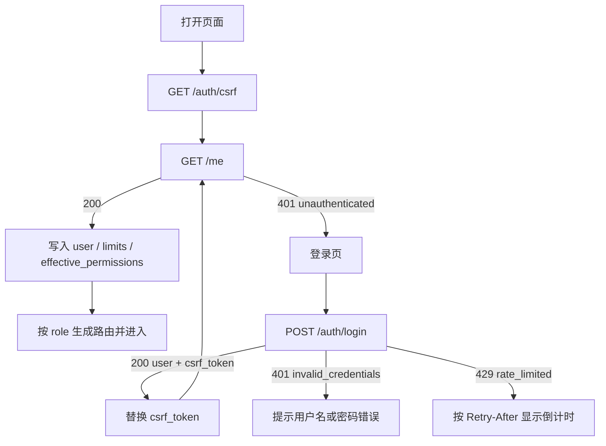
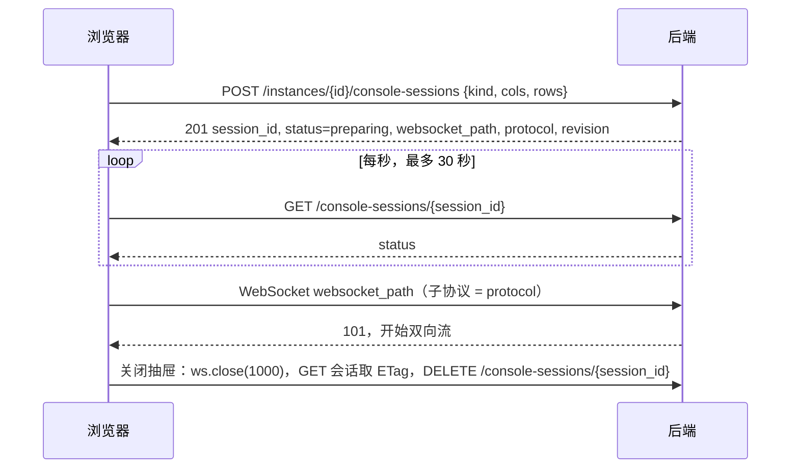

# 101cloud 前端设计

版本：v1（2026-10-30）。

依据：[后端接口文档](../backend/后端接口文档.md)、[openapi.json](../backend/openapi.json)、后端源码 `backend/internal/**`，以及 2026-10-30 在 192.168.0.111 上用管理员会话对 75 个 GET 接口做的只读采集。三者冲突时以**后端代码的实际行为**为准，冲突点列在第 13 节。

## 0. 总原则

1. 路径、字段名、枚举值、请求头一律照抄后端。前端不改名、不补字段、不发送接口未定义的字段（后端对未知字段返回 422）。
2. 前端不计算业务事实。价格、配额是否足够、GPU 是否可分配、能否创建，全部以后端返回为准（报价、`blocking_reasons`、错误码）。前端只做单位换算和格式化。
3. `null` 表示未知或不适用，显示"未知"或"—"，**不当作 0**。
4. `capabilities`、`effective_permissions` 只控制按钮显隐，后端每次重新授权；被拒绝时按错误码提示。
5. 没有 NAT、端口映射、公网端口申请页面。后端不提供这些接口。
6. 金额只显示 `pt`，不换算人民币。
7. 后端数据缺失、无法支撑的界面元素（第 13 节）不做"前端估算"替代，直接不显示或显示"暂不支持"。
8. 自定义实例需求在平台外提出和确认；平台内仅管理员直接下发。成员没有申请页面、申请按钮或创建失败后的申请链接，管理端没有申请审批入口，也不保留旧地址兼容跳转。

## 1. 技术基线

| 项 | 决定 |
|---|---|
| 模板 | Vue Vben Admin v5.7.0（MIT），锁定该 tag 作为基线 |
| 应用 | 只保留 `apps/web-antd`（ant-design-vue）；删除其余 apps、`backend-mock`、demo 页面、playground |
| 权限模式 | `accessMode: 'frontend'`，路由写死，按 `role` 过滤 |
| 语言 | 仅 zh-CN |
| 新增依赖 | `@xterm/xterm`、`@xterm/addon-fit`（容器终端）；`@novnc/novnc`（虚拟机 VGA） |
| 删除的模板能力 | accessToken / refreshToken、`Authorization` 请求头、锁屏、注册页、验证码、第三方登录、后端菜单接口、mock 请求 |

业务代码只放在 `apps/web-antd/src/`，尽量不改 `packages/`，方便以后手动合并上游：

```text
apps/web-antd/src/
  api/          request.ts（唯一请求客户端）+ 按后端模块分文件：auth, catalog, instances, gpu,
                monitoring, console, billing, requests, admin/*
  stores/       auth, csrf, tasks, credits, userCache
  composables/  useResource（详情+ETag）、useCursorList（游标分页）、useAction（幂等动作）、
                useQuote、useConsole
  components/   StatusTag, TimeText, CursorPager, ConfirmAction, UserName, TaskCenter
                （管理端页面专用组件放在各页面目录的 components/ 下）
  views/        member/*, admin/*
  locales/      errors.ts（错误码字典）, enums.ts（枚举中文）
```

## 2. 视觉规范

### 2.1 布局与主题

- Vben 侧边菜单布局：**浅色侧边栏**、浅色顶栏，菜单可折叠。
- 默认浅色主题，提供暗色切换。主色 antd 蓝 `#1677FF`。
- antd 紧凑模式；表格行高约 40px；内容区最大宽度不限（控制台需要横向空间）。
- 品牌：左上角文字 **101cloud**，暂无 Logo。以后加 Logo 只替换品牌位，不改布局。

### 2.2 颜色语义

| 语义 | 颜色 | 用于 |
|---|---|---|
| 正常 | success 绿 | 运行中、在线、已验证、成功、可用 |
| 进行中 | 主色蓝 | 排队、执行中、准备中 |
| 注意 | warning 橙 | 维护、宽限期、结果未知、指标过期、状态陈旧、草稿 |
| 错误 | error 红 | 失败、错误、额度耗尽、离线 |
| 中性 | 灰 | 已停止、已禁用、已退役、已取消、已释放 |

状态标签必须同时有文字，不能只靠颜色区分。枚举到中文和颜色的完整映射见附录 A。

### 2.3 字体与数字

- 正文：系统字体（PingFang SC / Microsoft YaHei / system-ui）。
- 等宽字体：ID、IP、UUID、PCI 地址、证书指纹、金额、费率、字节数。
- **pt 金额**：后端返回 6 位小数字符串（如 `"5.860000"`）。显示时只去掉末尾的 0 和多余小数点（`5.86`、`0.002`、`0`），**不四舍五入**。前端不对金额做加减乘除。
- **容量**：bytes 是十进制字符串。用 `BigInt` 换算成 GiB/MiB 显示，不能整除时保留最多 2 位小数并标注"约"。表单提交时用 `BigInt` 把 GiB 换回 bytes 字符串。
- `memory_mib`（GPU 显存）是整数，直接显示 MiB 或换算 GiB。

### 2.4 时间

- 后端返回 RFC3339、`+08:00`，最多 6 位小数。按字符串原样解析，**不按浏览器时区转换**。
- 显示规则：与当前时间同一天显示 `HH:mm:ss`；不同天显示 `MM-DD HH:mm`；跨年显示 `YYYY-MM-DD HH:mm`。鼠标悬停显示完整原值。
- 请求里的时间（筛选 `from/to`、`effective_at`、`expires_at`、`shutdown_deadline`）必须带时区，统一生成 `+08:00`。
- 倒计时（额度宽限、报价有效期）：用 `GET /credits/account` 返回的 `server_time` 与本机时钟求差，后续按差值校准。倒计时只用于展示，到点后前端不自行判定"已停止"，等待后端状态变化。

### 2.5 图表

- 使用 Vben 内置的 ECharts 封装。
- 后端值为 `null` 时该点断开，不连线、不补 0。
- 后端返回的 `gaps`、`collection_gaps` 区间画灰色斜线 `markArea`，标注"缺测"。
- 图上方显示覆盖率 `coverage.fraction`（百分比）。

### 2.6 通用交互

- 危险操作（删除、强制停止、移除/换卡、禁用用户、切换平台默认政策）弹确认框；删除实例要求输入实例名。
- 写操作按钮提交中进入 loading 并禁用，防止重复点击；收到 202 后按钮恢复，实际进度看任务。
- 422 在表单顶部显示安全中文主提示及 `details.field/fields` 字段校验信息；不把完整错误对象拼成单行 toast，字段路径不丢失。
- 列表用"上一页 / 下一页"，不显示总数和页码（后端是游标分页，不返回总数）。

## 3. 请求层契约

所有请求经过 `src/api/request.ts` 的唯一客户端，页面不直接调用 axios/fetch。

### 3.1 地址

- `baseURL` 固定为相对路径 `/api/v1`，开发和生产相同。
- WebSocket 地址 = `(location.protocol === 'https:' ? 'wss://' : 'ws://') + location.host + websocket_path`。`websocket_path` 由后端返回，已包含 `/api/v1` 或 `/api/v1/admin` 前缀，前端不拼前缀。
- 同源请求自动携带 Cookie，不设置 `Authorization`。

### 3.2 CSRF

- 后端使用两个 HttpOnly Cookie，名称随 `CLOUD_ORIGIN` 协议变化：HTTPS 为 `__Host-101cloud_session`（会话）、`__Host-101cloud_csrf`（CSRF 上下文），带 Secure；HTTP 为 `101cloud_session`、`101cloud_csrf`，不带 Secure。前端读不到，也不需要读，浏览器自动处理。
- `csrf_token` 来源：`GET /auth/csrf` 和 `POST /auth/login` 的响应 `data.csrf_token`。只保存在内存（Pinia，不持久化）。
- 登录成功后必须改用登录响应里的新 token；旧 token 与新会话不匹配。
- 除 GET 外的所有请求都带 `X-CSRF-Token`，包括登录、退出。
- CSRF 上下文有效期 30 分钟。在有效期内再次请求 `/auth/csrf` 返回同一个 token，不会续期，所以**不做定时预刷新**。
- 收到 `403 csrf_failed`：重新 `GET /auth/csrf`，用新 token **重发一次原请求，Idempotency-Key 不变**。后端在 CSRF 中间件拒绝时还没有执行任何业务逻辑，重发是安全的。仍失败则提示"请刷新页面"。

### 3.3 请求头矩阵

| 请求 | `X-CSRF-Token` | `Idempotency-Key` | `If-Match` |
|---|---|---|---|
| GET | — | — | — |
| `POST /auth/login`、`POST /auth/logout` | 必须 | — | — |
| 创建新资源的 POST（`/instances`、`/quotes`、`/credits/redemptions`、`/admin/users`、`/admin/custom-instances`、`/admin/redemption-codes`、`/admin/{collection}` 创建等） | 必须 | 必须 | — |
| 对已有资源的动作 POST（start/stop/restart/resize、gpu-*、probe、drain、validate、publish、retire、reconcile、extend、reset-password、disable、adjustments、addresses 等） | 必须 | 必须 | 必须 |
| PATCH、PUT | 必须 | — | 必须 |
| DELETE | 必须 | 必须 | 必须 |

例外与实测差异：

| 接口 | 处理 |
|---|---|
| `POST /me/password` | OpenAPI 未列 `If-Match`，但后端代码强制检查。发送 `/me` 的 ETag |
| `POST /instances/{id}/console-sessions` | OpenAPI 列了 `If-Match`，后端当前未检查。仍发送实例 ETag，与契约一致 |
| `POST /quotes` | 后端写请求中间件对所有 POST 要求幂等键，报价也要带 |

请求体规则：

- 所有写请求的 body 必须是 JSON 对象；无参数的动作发送 `{}`。DELETE 有参数时也放在 JSON body 里。
- body 上限 1 MiB；重复键、尾随内容、非对象 body 都会被拒绝（400 `invalid_json` 或 422）。
- 只发送该接口定义的字段。实例 stop 只有 `mode`、`confirm_data_loss_risk`；管理员操作不发送操作理由。

### 3.4 版本号（ETag / If-Match）

- 格式：`"rev-{revision}"`，包含双引号，原样放进 `If-Match`。
- 来源优先级：详情 GET 响应头 `ETag` > 列表项的 `revision` 字段（自行拼成 `"rev-" + String(revision)`）。`revision` 在多数接口是字符串，在 `limits` 中是整数，统一 `String()`。
- `useResource` 把数据和 ETag 一起缓存；每次写成功后重新 GET 详情刷新两者。**202 响应不带新 ETag**，任务受理后后端版本已经前进，必须重新读取。
- `412 revision_conflict`：提示"数据已被其他操作修改"，自动刷新详情，**不自动重新提交**，由用户确认后再操作。
- `428 precondition_required`：前端编码错误，记入控制台日志，提示"请刷新后重试"。

各资源 ETag 来源：

| 操作对象 | If-Match 取自 |
|---|---|
| 实例的生命周期、GPU、终端、重命名、GPU 策略 | `GET /instances/{id}`（管理端 `/admin/instances/{id}`）的 ETag。GPU 策略也可用 `GET .../gpu-policy` 的 ETag，两者都是实例 revision |
| 本人资料、改密码 | `GET /me` 的 ETag |
| 撤销会话 | `GET /me/sessions` 列表项的 `revision` |
| 关闭终端会话 | `GET /console-sessions/{session_id}` 的 ETag（状态每次变化 revision 都会增加，关闭前先 GET） |
| 通知已读 | 列表项 `revision` |
| 其他管理资源 | 对应详情 GET 的 ETag |

### 3.5 幂等键

- 格式：`crypto.randomUUID()`（36 个可打印 ASCII 字符，符合后端 1–128 的要求）。
- **一次用户意图一个键**：在用户点击"确认"时生成，存在该动作的状态里。
- 同一次提交因网络错误、超时、5xx、`csrf_failed` 重发时**复用原键**。
- 用户修改表单后重新提交，生成新键。复用旧键提交不同内容会得到 `409 idempotency_conflict`，这是前端缺陷，不自动处理。
- 报价：请求体不同就用新键；同一请求体的重试复用键。
- 后端对同键同内容的重放返回原结果（包括原状态码），前端按正常结果处理。

### 3.6 响应与分页

```json
{"data": {...}, "request_id": "req-xxxx"}
{"data": {"items": [...], "next_cursor": "..."|null}, "request_id": "req-xxxx"}
{"error": {"code": "...", "message": "...", "details": null|{}}, "request_id": "req-xxxx"}
```

- 例外：`GET /instances/{id}/gpu-allocations` 和 `GET /instances/{id}/network`（含管理端同名接口）的 `data` 是数组，不是分页对象。
- 204 无 body。202 的 `data` 是 `{task_id, instance_id, status}`，`instance_id` 可为 `null`。
- 请求层保留 `{status, code, message, details, request_id}`。`describeError` 对同步 `ApiError` 和任务公开错误使用同一格式器：后端安全中文具体说明优先，英文/空 message 才查第 12 节中文码表；未知码或非协议异常使用安全中文通用提示，不显示原始异常、上游响应或任意 details。`request_id` 独立显示且可复制，不塞入主标题；任务查询保留本次响应的请求 ID。
- **游标分页**：`limit` 1–100，默认 20；`cursor` 不透明；按 `created_at`、`id` 倒序；不返回总数。
- `CursorPager` 组件维护游标栈实现上一页/下一页。筛选条件改变时清空游标栈；`400 invalid_cursor` 时回到第一页。
- 只传接口声明的筛选参数，多传一个会得到 `422 unknown query parameter`。
- `PublicErrorSchema` 校验 `{code: string, message: string, details: object|null}`；`ErrorDetailsSchema` 只消费公开契约字段。主提示最长 100 字，剩余原文、资源数字、字段和行动建议放到独立详情；详情可滚动，错误码和阶段保留在“技术详情”。后端原文已给出的数字按维度去重，未给出的数量仍补充显示。

公开错误详情 schema（所有数量均为十进制字符串，不经 `Number`）：

```ts
type PublicError = { code: string; message: string; details: Record<string, unknown> | null };
type ResourceErrorDetails = {
  scope?: 'user_quota' | 'node_capacity' | 'resident_capacity' | 'storage_pool' | 'ip_pool' | 'gpu';
  resource?: 'instances' | 'resident_instances' | 'vcpus' | 'memory_bytes' | 'disk_bytes' | 'gpus' | 'addresses';
  used?: string; requested?: string; limit?: string; available?: string;
  total?: string; // 存储池物理总量；与 limit 相等时只展示一次
  unit?: 'bytes' | 'count' | 'pt';
  pool?: string;
  field?: string; // 如 resources.disk_bytes
  fields?: Record<string, string | string[]> | { field: string; message: string }[];
  action?: string; // 安全中文处理建议
  stage?: string;
};
```

- `bytes` 使用 `formatBytes`（BigInt）；`count` 原字符串显示，`pt` 使用 `formatPt` 去尾零，均不损失精度。范围和资源维度翻译成中文，`action` 独立展示，`stage` 留在技术详情。


### 3.7 字段类型

| 类型 | 规则 |
|---|---|
| ID | 十进制字符串，不转 Number。GPU UUID、`session_id` 是不透明字符串 |
| 字节数（`*_bytes`） | 十进制字符串，`BigInt` 处理 |
| pt 金额、费率 | 十进制字符串。输入校验用正则 `^\d+(\.\d{1,6})?$`；需要比较大小时把字符串按 6 位小数放大成 `BigInt` 比较，不用浮点 |
| 百分比、秒数、数量、vCPU | JSON 数字 |
| 布尔 | `true/false`；可能为 `null` 的布尔（如 GPU 分配的 `configured`、`observed`）显示"未知" |
| JSON 字段 | 列表与详情返回同样的对象/数组 |

## 4. 登录、路由与权限

### 4.1 启动流程



- 登录页只有用户名、密码。没有注册、验证码、第三方登录、"记住我"。账号由管理员创建。
- `429 rate_limited`：读取响应头 `Retry-After`（秒），按钮显示"请在 N 秒后重试"并禁用。同一用户名 15 分钟最多 10 次，同一来源 IP 最多 50 次。
- 退出：`POST /auth/logout`（body `{}`），清空所有 store，回到登录页。

### 4.2 会话失效

- 任意请求返回 `401 unauthenticated`，弹出"登录已过期"对话框，在对话框内重新登录，不丢失当前页面状态（Vben `loginExpiredMode: 'modal'`）。
- 用户名或密码错误（登录）、当前密码错误（改密码）返回 `401 invalid_credentials`，只在表单内提示，不触发登录过期流程。改密码失败不会使会话失效。
- Vben 模板需要改造：路由守卫不再检查 accessToken，改为检查 `authStore.user` 是否已加载；删除 refresh token 拦截器。

### 4.3 路由与菜单

- `/me` 返回 `user.role`：`user` 或 `admin`。
- 普通用户只有"成员"菜单。管理员同时拥有"成员"菜单（管理员自己的资源）和"管理"菜单。
- 管理路由 `meta.authority: ['admin']`；`/admin/*` 接口后端要求 admin 角色，前端隐藏只是体验优化。
- `effective_permissions` 实际值：所有用户 `catalog:read, instances:own, billing:own, sessions:own, profile:own`，管理员额外 `admin`。按钮级控制用 Vben `AccessControl type="code"` 读这些值。

## 5. 全局框架

### 5.1 顶栏

| 元素 | 数据 | 刷新 |
|---|---|---|
| 可用额度 | `GET /credits/account` → `available_pt` | 60 秒；创建/启动实例的任务结束后立即刷新 |
| 任务中心 | 本地任务 store（5.3） | 实时 |
| 通知 | `GET /notifications?unread_only=true&limit=1`，有项显示红点 | 60 秒 |
| 用户菜单 | `user.username`；个人设置、退出 | — |

`GET /credits/account` 返回 404 或错误时，顶栏不显示额度，不影响其他功能。

### 5.2 额度宽限横幅

- `GET /credits/account` 的 `enforcement` 不为 `null` 且 `status` 为 `grace`、`stopping`、`unknown` 时，所有成员页面顶部显示红色横幅。
- 内容：`exhausted_at` 额度耗尽；`shutdown_deadline` 前的倒计时；涉及实例 `instance_ids`（链接到详情）；固定说明"宽限期内可以使用终端、保存数据或主动停止；到期后平台强制停止，磁盘不删除"。
- `stopping` 显示"正在停止"，`unknown` 显示"停止结果待核对"。
- 横幅不可关闭，状态变化以后端为准。

### 5.3 任务中心

- 所有 202 响应的 `task_id` 加入任务 store，同时记录发起页面和关联 `instance_id`。
- 轮询 `GET /tasks/{id}`（管理员发起的任务用 `GET /admin/tasks/{id}`）：前 30 秒每 2 秒一次，之后每 5 秒一次，到终态停止。
- 终态：`succeeded`、`failed`、`cancelled`。完成后刷新关联实例详情和列表。
- `unknown`：不是终态。显示"结果待核对"，改为每 15 秒查询一次；详情的 `next_action` 为 `administrator_reconcile` 时提示"需要管理员核对"。前端**不重新发起同样的操作**。
- 任务列表与详情字段相同，都包含 `steps` 和 `next_action`。
- 刷新页面后任务 store 清空；实例的 `active_task_id` 不为空时，实例页自动把该任务重新加入跟踪。
- 抽屉内容：`type`（中文，见附录 A）、`status`、`phase`、`created_at/started_at/finished_at`、可读失败原因与建议、`steps[]`。任务与步骤均新增可选可空 `error: PublicError|null`，保留 `error_code: string|null`，缺失结构化错误的历史记录才按 `error_code` 查中文码表兜底；未知代码不伪造失败原因。步骤名仍原样等宽显示，错误码在技术详情中保留。
- `TaskSchema`、`TaskStepSchema`、`TaskPageSchema` 在任务 API 边界校验现有字段及新增 `error`；表格插槽的未知行在错误格式器入口经具名 `TaskErrorSourceSchema` 校验任务/步骤共用的 `error/error_code/status`。格式异常使用安全中文提示，保留请求 ID，不将任意 JSON 强制断言成 Task。
- 任务 schema 增量：`Task.error?: PublicError|null`、`TaskStep.error?: PublicError|null`、`Task.resource_reservations_released?: boolean`。`failed` 不显示重试按钮；`next_action=correct_and_resubmit` 只说明修正原因后重新提交创建，`inspect_failure` 要求先检查实际状态；`unknown` 始终核对而非重放。
- 实例创建失败横幅显示最近失败任务的具体错误。`resource_reservations_released=true` 才显示“创建前失败，IP/GPU及计费预留已释放，可调整配置后重新创建”；false/缺失显示“资源预留未确认释放，请查看任务/请求管理员核对”。旧失败记录不推定已释放，不清除历史。

### 5.4 通用组件

| 组件 | 说明 |
|---|---|
| `StatusTag` | 输入枚举类型和值，输出中文 + 颜色（附录 A） |
| `PtAmount` | pt 字符串去尾零显示，可带 `/h` 后缀 |
| `Bytes` | bytes 字符串 → GiB/MiB |
| `Time` | 2.4 节规则 |
| `Countdown` | 基于 `server_time` 校准 |
| `CursorPager` | 游标栈上一页/下一页 |
| `ConfirmAction` | 通用确认框：可要求输入名称、勾选风险项，保留危险操作提示；`onConfirm` 为无参回调，成功返回 `true` 后关闭，不收集操作理由 |
| `UserName` | 输入 `user_id`，通过 `userCache` 调 `GET /admin/users/{id}` 显示用户名（仅管理端） |

## 6. 成员端页面

当前已开放：管理员与成员共用登录，成员默认进入 `/instances`，仅一个“实例管理”菜单，页面为只读实例卡片首页。顶栏显示可用额度，点击查看剩余额度与已预留额度。创建、详情/操作、独立概览、账单、通知及个人设置尚未开放；下述其他页面为后续设计，不代表已实现。

### 6.1 概览 `/dashboard`（后续设计，未开放）

| 卡片 | 数据来源 | 内容 |
|---|---|---|
| 额度 | `GET /credits/account` | `available_pt`、`next_grant_at`；`enforcement` 不为空时显示红色状态 |
| 实例 | `GET /instances?limit=100`，有 `next_cursor` 继续取（总数受 `max_instances` 限制） | 按组合状态（附录 A.1）计数 |
| 配额 | `GET /me` 的 `limits` + 上面的实例列表 | 见下 |
| 最近通知 | `GET /notifications?limit=5` | 类型、时间、未读标记 |
| 最近任务 | `GET /tasks?limit=5` | 类型、状态、时间 |

配额卡：

- 上限取 `limits`：`max_instances`、`max_resident_instances`、`max_vcpus`、`max_memory_bytes`、`max_disk_bytes`、`max_gpus`。
- 实例数、vCPU、内存、磁盘的已用量 = 实例列表的数量和 `resources` 求和。列表与后端准入使用同一口径（未删除的实例），所以结果一致。后端提供用量接口后改为直接读取（13 节 B4）。
- GPU 已用量没有接口，只显示上限。
- 上限全为 0 时显示"尚未分配资源配额，请联系管理员"。新账号默认全部为 0。

### 6.2 实例管理首页 `/instances`（已实现）

接口：`GET /instances`，使用本人资源范围；筛选为 `product_type`（elastic/custom）、`observed_state`。没有名称或 IP 搜索，不放仅搜索当前页的搜索框。每页 20 条，使用游标上一页/下一页。

布局为响应式卡片：窄屏单列、桌面双列、宽屏三列。卡片只读，不生成未实现的详情链接或操作按钮。

| 区域 | 内容 |
|---|---|
| 标识 | 实例名称、ID、容器/虚拟机类型、标准/自定义产品类型；系统名称/版本来自 `image_os_name/image_os_release`，复用 `OsIcon` 的本地系统镜像图标，未知系统回退 Linux，不按实例名猜测 |
| 状态 | 组合状态；`active_task_id` 非空时标记操作中；过期观测明确标记未知及最近观测时间 |
| 规格 | `resources.vcpus` vCPU、内存及磁盘分配容量，不冒充实时使用率 |
| 内网 IPv4 | 独立读取 `GET /instances/{id}/network`，只展示状态 bound 且配置绑定确认的 RFC1918 私有 IPv4；多地址逐行展示，排除 IPv6、公网和仅预留地址。过期状态标注，地址可直接选中复制 |
| GPU | 独立请求 `GET /instances/{id}/gpu-allocations`（数组），按型号和分配状态汇总数量；排除已释放、已取消记录，区分预留/挂载/释放/失败/未知。`active + configured=true` 显示已挂载；`observed` 是 GPU 上下文/设备引用观测，不是挂载开关，空闲或停止时为 false 不误报未挂载；active 的配置缺失/未知仍提示待核对 |
| 额度提示 | 根据 `credit_enforcement` 显示宽限期限、正在停机或状态待核对，不推算实例到期时间 |

初始加载显示卡片骨架，初始失败显示错误与刷新，成功为空显示空状态。刷新/翻页/筛选失败保留旧卡片并明确标记旧结果，避免误报空列表。GPU、网络查询互不阻塞卡片主体，失败保留旧结果并提示；无已绑定私网地址显示“未分配内网 IPv4”。费率、地域、续费及未实现的创建/操作入口不显示。

列表可见时，有任务、未就绪、pending 或额度宽限/停机/未知状态时每 10 秒刷新，否则每 30 秒。GPU 分配及网络地址随成功列表刷新独立更新。

成员顶栏通过 `GET /credits/account` 显示 `available_pt`，单位 Pt；点击浮层展示 `remaining_pt`、`reserved_pt` 和服务端额度停机信息。初始化、可见时每 30 秒及手动刷新；加载为 `—`，失败不归零，有旧值则保留并标记失败。成员不挂载管理员任务中心。退出、登录过期及账号切换清理额度数据。


### 6.3 创建实例 `/instances/create`

单页表单，左侧填写，右侧固定费用卡。不做分步向导。

#### 数据加载

| 步骤 | 请求 | 用法 |
|---|---|---|
| 套餐 | `GET /catalog/plans?instance_type=` | 先选类型（容器/虚拟机），再列套餐 |
| 镜像 | `GET /catalog/images?instance_type=` | 只保留 `id` 在套餐 `image_ids` 中的项 |
| 网络 | `GET /catalog/network-options?instance_type=` | `instance_type` 必填，缺少返回 422。只保留 `id` 在套餐 `network_option_ids` 中的项。实例落在所选网络绑定所属的节点（项中的 `node_id`） |
| GPU 信息 | `GET /catalog/gpu-options` | 只用于展示单价、显存、是否有可用卡，不决定能否创建 |
| 额度 | `GET /credits/account` | 显示 `available_pt` |

套餐对象字段：`id, code, version, name, status, instance_type, resources{vcpus, memory_bytes, disk_bytes}, gpu{count, model, access_mode, max_hourly_pt}, gpu_policy{idle{enabled, timeout_seconds, action}, rebalance{enabled, allow_live, max_hourly_pt}}, allowed_user_actions[], gpu_user_permissions{}, allowed_overrides, policy_versions, node_ids[], image_ids[], network_option_ids[], pricing_version_id, init_template_version_id, revision`。

#### 表单字段

| 字段 | 规则 |
|---|---|
| 类型 | `container`（可挂 GPU）/ `virtual-machine`（不支持 GPU） |
| 套餐 | 卡片显示 `name`、`version`、基准规格、GPU 数量和型号。**不显示价格**：普通用户读不到套餐的价格政策，价格只在报价后出现（13 节 B3） |
| vCPU / 内存 / 磁盘 | `allowed_overrides` 中有该项（`min`、`max`、`step`）时用滑块，取值 = `min + k × step`；没有该项时固定为套餐 `resources` 基准值，显示为只读。内存、磁盘用 `BigInt` 计算，显示 GiB |
| 镜像 | 显示 `name`、`version`、`architecture`。GPU 数量大于 0 时，`gpu_ready` 为假的镜像禁用并说明"该镜像不支持 GPU" |
| 网络 | 显示"直连网络 #`id`（`mode`）"，IP 由后端自动分配。只有一项时自动选中。后端不返回网络名称和网段（13 节 B5） |
| GPU 数量 | 仅容器套餐。选项 = "不带 GPU"（0）+ 套餐允许的数量：`allowed_overrides.gpu_count` 有值时为 `min`–`max` 中按 `step` 的值（0 已在第一项），否则为套餐 `gpu.count`（大于 0 时）。默认值为套餐 `gpu.count`。套餐 `gpu.model` 为空时只有"不带 GPU" |
| GPU 型号、共享/独占 | 取套餐 `gpu.model`、`gpu.access_mode`，**只读**。后端不允许覆盖 |
| GPU 单价上限 `max_hourly_pt` | 默认套餐 `gpu.max_hourly_pt`，可调低，不能高于该值（后端校验）。比较用 6 位小数 `BigInt` |
| 名称 `name` | 必填，1–128 字符。Incus 内部名由后端生成 |
| 初始化参数 | 固定发送 `{}`。套餐 `init_template_version_id` 不为空时提示"该套餐带初始化脚本，当前版本不支持填写参数"（13 节 B6） |

选 0 张 GPU（包括虚拟机套餐，GPU 区隐藏）时，请求中 `gpu` 发送 `{count: 0, model: null, access_mode: <套餐值，空时 "shared">, max_hourly_pt: <套餐值，空时 "0">}`。不收 GPU 费用，但仍须遵守套餐的节点/网络范围和 GPU 单价上限，不能用创建请求提高后续分配或均衡的价格上限。

#### 报价

- 表单字段全部合法后，任何改动防抖 400ms 调用 `POST /quotes`，body 为 CreateElasticSpec：`name, plan_id, plan_revision?, image_id, network_option_id, resources, gpu, init_parameters`（不含 `policy_versions`）。可提交已加载的套餐 `revision`；若已变化则返回 `409 plan_changed`。节点由所选网络绑定决定。
- 报价不是预留。响应：

| 字段 | 显示 |
|---|---|
| `price_details.cpu_hourly_pt` / `memory_hourly_pt` / `disk_hourly_pt` / `gpu_hourly_pt` | 各项小计（pt/h）。后端只给小计，不给单价 |
| `price_details.total_hourly_pt` | 合计 pt/h，大字 |
| `initial_window_pt` | "首个计费窗口需预留 N pt"。仅额度账户正常时返回 |
| `admissible`、`blocking_reasons[]` | 可创建 / 阻止原因列表（下表） |
| `expires_at` | 报价有效期倒计时（5 分钟） |
| `policy_versions` | 不显示，创建时原样提交 |
| `plan_revision` | 不显示，创建时必须原样提交，防止报价后套餐被修改 |

右侧费用卡同时显示"可用额度 `available_pt`"和 `/me` 的配额上限。**不显示"可运行多少小时"**，前端不做金额除法。

阻止原因：

| `blocking_reasons` 值 | 中文 |
|---|---|
| `node_unavailable` | 节点不可用（维护中或离线） |
| `inventory_stale` | 节点资源数据过期，请稍后重试 |
| `insufficient_vcpus` / `insufficient_memory_bytes` / `insufficient_disk_bytes` | 节点剩余 vCPU / 内存 / 磁盘不足 |
| `no_registered_address_available` | 没有可分配的 IP 地址 |
| `insufficient_gpu_capacity_or_metrics` | 没有满足条件的空闲 GPU，或 GPU 指标不完整 |
| `gpu_price_exceeds_limit` | GPU 当前单价高于你设置的上限 |
| `quota_not_configured` | 账号尚未配置配额 |
| `quota_exceeded_instances` / `_vcpus` / `_memory_bytes` / `_disk_bytes` / `_gpus` | 超出实例数 / vCPU / 内存 / 磁盘 / GPU 配额 |
| `credit_account_unavailable` | 额度账户不可用 |
| `insufficient_credit` | 可用额度不足以支付首个计费窗口 |
| 其他值 | 原样显示 |

不可创建时，"创建实例"按钮禁用，费用卡下方列出阻止原因；不显示自定义实例申请链接。

报价错误：`422 validation_failed` 显示 message；`409 policy_not_configured` "平台尚未配置价格或额度政策，请联系管理员"；`409 conflict`（套餐未启用）"套餐已停用，请重新选择"；`409 policy_changed` 重新加载套餐后再报价；`409 plan_changed` 重新加载套餐配置并重新报价，用户确认后再提交，不自动创建。

#### 创建

- 按钮可用条件：最近一次报价 `admissible=true` 且未过期，且报价后表单没有改动。报价已过期时，点击先重新报价，用户需要再点一次确认。
- `POST /instances`，body = 报价时的 CreateElasticSpec + 报价返回的 `plan_revision`（必填，须与当前套餐一致）及 `policy_versions`。幂等键在点击时生成，重试复用。
- 202：任务加入任务中心，跳转 `/instances/{instance_id}`。
- `409 policy_changed`：重新报价，弹窗显示新的合计费用，用户确认后用新键重新提交。
- `409 plan_changed`：套餐在报价后发生编辑或启停，重新加载套餐与可选配置、重新报价并要求用户确认，不自动重试创建。
- `409 quota_exceeded / credit_exhausted / gpu_capacity_unavailable / ip_capacity_unavailable / node_unavailable / node_capacity_unavailable / storage_pool_capacity_exceeded`：显示后端具体中文原因、范围/维度、用量和行动建议（英文信息用码表兜底），不自动重新提交创建。

### 6.4 实例详情 `/instances/:id`

加载：`GET /instances/{id}`（数据 + ETag）、`GET /instances/{id}/network`。`product_type=custom` 时另取 `GET /instances/{id}/gpu-policy` 的 `allowed_user_actions`（实例对象不含该字段，13 节 B7）。

#### 头部

- 名称：可编辑，`PATCH /instances/{id}` `{name}`。
- 组合状态、"自定义"、"免额度"标签；额度宽限倒计时（同列表）。
- 信息行：类型；镜像名（从 `GET /catalog/images?instance_type=` 按 `image_id` 查找，查不到显示"镜像 #id"）；套餐名（`plan_id` 不为空时 `GET /catalog/plans/{plan_id}`，404 显示"套餐 #id（不可用）"；仅作当前名称展示，不用于规格范围）；IP（网络第一项 `ip`，可复制）；"状态更新于 N 秒前"（`observed_at`）。

#### 操作按钮

`active_task_id` 不为空时全部禁用，显示"操作进行中"并链接任务。`state_stale=true` 时生命周期按钮全部隐藏，只显示"状态未知，等待同步"。

| 按钮 | 显示条件 | 请求 |
|---|---|---|
| 终端 / 控制台 | `capabilities.console` | 6.5 节 |
| 启动 | `capabilities.start` | `POST /instances/{id}/start` `{}` |
| 重启 | `observed_state=running`，且（elastic 或 `allowed_user_actions` 含 `restart`） | `POST .../restart` `{"mode":"graceful"}` |
| 停止 | `capabilities.stop` | `POST .../stop` `{"mode":"graceful"}` |
| 调整规格 | `observed_state=stopped`，且（elastic 或含 `resize`） | 见下 |
| 删除 | `observed_state=stopped`，且（elastic 或含 `delete`） | 见下 |

- 普通用户**没有强制停止**：后端对非管理员的 `mode=force` 返回 `403 force_not_allowed`。
- 所有动作带 CSRF、幂等键、实例 ETag。

**调整规格**：

- 每次打开调整弹窗或切换实例时重置表单并只读请求 `GET /api/v1/instances/{id}/resize-limits`（管理端使用 `/api/v1/admin/instances/{id}/resize-limits`）。返回 `data.max_resources: {vcpus: number, memory_bytes: string, disk_bytes: string}`：综合所有者配额、节点可分配容量与自定义常驻预算，扣除其他实例预留且排除当前实例，表示本实例允许的**总量**而非增量。关闭、重开或实例切换后忽略过期响应。
- elastic：将实时上限与实例响应 `plan_snapshot: {revision, vcpus, memory_bytes, disk_bytes, allowed_overrides}` 中的冻结范围、原始 min 起算步进取交集；无覆盖项保持冻结基准值。body `{resources}`（不再发送 `policy_versions`）；后端沿用实例冻结的价格和政策。当前套餐编辑、停用或引用变化不影响已有实例。custom 的 `plan_snapshot=null`，不受套餐范围限制，body `{resources}`。两者 vCPU 均不超过 65535，磁盘下限不小于当前 `disk_bytes`（禁止缩容）。
- 数字输入展示允许总量范围并设置 min/max；容量以 BigInt 先将下限向上、上限向下取到三位小数 GiB，内存最小为 0.001 GiB。校验继续使用字节整数和套餐原始步进；实时上限按套餐合法步进向下截断。上限低于下限时明确提示当前配额和节点容量下无法调整，不将当前规格伪装为可用范围。
- 加载期间或读取失败时不回退到“不限”，禁用提交；显示加载/错误详情和可重试的刷新按钮。可用容量是只读快照，可能随其他实例变化；提交仍由后端权威检查，不修改实时规格或配额。
- 实例必须已停止，否则 `409 unsupported_configuration`。后端没有调整规格的报价接口，弹窗不显示新费用（13 节 B8）。

**删除**：确认框要求输入实例名；body `{confirm_name: <输入值>, delete_data: true}`；说明"实例和磁盘数据将被永久删除"。后端要求实例处于近期确认的停止状态，否则 `409 invalid_state`。

#### 标签页

**概览**

| 卡片 | 内容 |
|---|---|
| 配置 | vCPU、内存、磁盘、类型、`product_type`、`billing_mode`、套餐、镜像、`created_at` |
| 网络 | 每项：`ip/prefix_length`、`gateway`、`dns[]`、`mode`、`status`；`quality.state_stale=true` 时提示"网络状态可能已过期" |
| 实时 | 最新指标摘要（CPU、内存、每张 GPU），来自监控页同一接口 |
| 计费 | `GET /usage/sessions?instance_id=&status=active`：每项 `charge_kind` 和单价快照（`cpu_hourly_pt` 等为**单价**，按"每 vCPU·小时"等标注）；`GET /usage/charges?instance_id=&limit=5`：最近扣费 `from_at~to_at`、`expected_pt`、`settled_pt`、`status`。后端不提供实例当前总费率，不显示（13 节 B9） |

**监控**

最新值：`GET /instances/{id}/metrics/latest`，标签页可见时每 10 秒刷新。

| 字段 | 显示 |
|---|---|
| `cpu.allocation_percent` | CPU 使用率（相对已分配 vCPU）；`null` 显示"未知" |
| `memory.used_bytes` / `memory.limit_bytes` | 内存已用 / 上限 |
| `gpus[]` | 每张卡：`model`、`sm_utilization_percent`、`used_memory_bytes` / `memory_total_bytes`、`process_count`、`state`、`configured`、`observed` |
| `stale`、`age_seconds` | `stale=true` 时橙色"数据已过期（N 秒前）" |
| `quality.reasons[]` | 原因码标签，悬停显示说明（附录 A.6） |
| `503 metrics_unavailable` | "暂无采样数据" |

后端不返回进程 PID、进程名、命令行，前端也不展示进程列表。

历史：`GET /instances/{id}/metrics/history`。

- 时间范围：1 小时、6 小时、24 小时、7 天、30 天、自定义。`from`、`to` 带 `+08:00`。
- `resolution=auto`：后端在 6 小时内返回 raw，7 天内分钟级，90 天内小时级，更长按天。响应 `resolution` 是实际粒度。
- `limit=1000`，沿 `next_cursor` 继续取直到为空；最多取 10 页，超过提示"数据量过大，请缩小时间范围"。
- 选择单张 GPU 时传 `gpu_uuid`。

| 曲线 | raw 点 | 汇总点（minute/hour/day） |
|---|---|---|
| 横轴 | `sampled_at` | `bucket_start_at` |
| CPU % | `cpu.allocation_percent` | `cpu_utilization_avg_pct`，峰值 `cpu_utilization_peak_pct` |
| 内存 | `memory.used_bytes` | `memory_used_avg_bytes`，峰值 `memory_peak_bytes` |
| GPU SM % | `gpus[].sm_utilization_percent`（按 `uuid`） | `gpus[].utilization_avg_pct`，峰值 `utilization_peak_pct`（按 `gpu_uuid`） |
| GPU 显存 | `gpus[].used_memory_bytes` | `gpus[].memory_used_avg_bytes`，峰值 `memory_peak_bytes` |

- `null` 断线。`gaps[]`（`from`、`to`、`reason`）和 `collection_gaps[]`（`from_at`、`to_at`、`reason`）画缺测区域；原因中文见附录 A.6。
- 图上方显示 `coverage.fraction` 覆盖率。
- 请求范围超出保留期时，按 `available_range` 提示可查询的最早时间。

**GPU**（仅容器）

列表：`GET /instances/{id}/gpu-allocations`（数组）。默认隐藏 `released`、`cancelled`、`failed`，可切换"显示历史"。

| 列 | 字段 |
|---|---|
| 型号 | `model` |
| UUID | `uuid`（截断，悬停全称） |
| 状态 | `status`（附录 A.4）；`release_verified=false` 且状态为 `releasing/unknown` 时警告"旧卡释放未确认" |
| 已配置 / 已观测 | `configured`、`observed`（`null` 显示"未知"） |
| SM / 显存 / 进程数 | 按 `uuid` 关联最新指标的 `gpus[]` |
| 单价 | `gpu_hourly_pt` pt/h（分配时的快照） |
| 分配时间 | `created_at`；已释放显示 `released_at` |

挂载 GPU（`capabilities.gpu_attach`）：

- 表单：数量 `count`（≥1）；型号与共享模式从 `GET /catalog/gpu-options?node_id=<实例 node_id>` 选择（`model` + `access_mode`，显示单价、显存、`availability`）；单价上限 `max_hourly_pt`（默认所选项的 `gpu_hourly_pt`）。后端挂载接口不接收 `min_memory_mib`（字段标记为 `json:"-"`，只在换卡时由后端内部计算），前端不提供该项。
- 实例运行中必须勾选"运行中挂载：CUDA 程序可能需要重新初始化"，发送 `allow_live: true`；已停止发送 `false`。
- `POST /instances/{id}/gpu-attachments` `{count, model, access_mode, max_hourly_pt, allow_live}`。后端按最低负载选卡，用户不能指定具体卡。

移除 GPU（elastic 或 `allowed_user_actions` 含 `gpu_detach`）：只能选择 `status=active` 的分配；`POST .../gpu-detachments` `{allocation_ids, allow_live}`。`409 gpu_in_use` 提示"GPU 仍有进程或显存占用，请先结束程序或停止实例"；`409 observation_incomplete` 提示"缺少完整的空闲证据，请稍后重试"。

换卡（`capabilities.gpu_rebind`）：选择分配，填写 `max_hourly_pt`；`POST .../gpu-rebindings` `{allocation_ids, max_hourly_pt, allow_live}`。确认框说明"运行中换卡不会迁移 CUDA 上下文"。

**网络**：网络卡片的完整版，加 `observed_at`、`quality.configuration_bound`。

**任务**：`GET /tasks?instance_id={id}`，游标分页；点击打开任务抽屉。

**GPU 策略**（仅容器）

`GET /instances/{id}/gpu-policy` 返回：

- 用户配置：`idle{enabled, timeout_seconds, action}`、`rebalance{enabled, allow_live, max_hourly_pt}`。
- `allowed_ranges.idle{enabled, allowed_actions[], default_timeout_seconds, min_timeout_seconds, max_timeout_seconds}`、`allowed_ranges.rebalance{min_hourly_pt, max_hourly_pt, allow_price_increase}`、`allowed_ranges.editable{idle, idle_timeout, idle_action, rebalance, allow_live, max_hourly_pt}`。
- 只读：`effective_policy{idle, rebalance, safety{...}}`、`blocked_reasons[]`、`idle_since`、`last_rebound_at`、`policy_versions`。

| 表单项 | 可编辑条件 | 范围 |
|---|---|---|
| 空闲回收开关 `idle.enabled` | `editable.idle` 且 `allowed_ranges.idle.enabled` | — |
| 空闲时长 `idle.timeout_seconds` | `editable.idle_timeout` | `min_timeout_seconds`–`max_timeout_seconds` |
| 空闲动作 `idle.action` | `editable.idle_action` | `allowed_ranges.idle.allowed_actions`：`detach_gpu` 移除 GPU / `stop_instance` 停止实例 |
| 自动均衡开关 `rebalance.enabled` | `editable.rebalance` | — |
| 允许运行中换卡 `rebalance.allow_live` | `editable.allow_live` | — |
| 均衡单价上限 `rebalance.max_hourly_pt` | `editable.max_hourly_pt` | `min_hourly_pt`–`max_hourly_pt` |

- `allowed_ranges.idle.enabled=false` 时空闲区整体只读，显示"平台未启用空闲回收"。
- 保存：`PUT /instances/{id}/gpu-policy`，提交完整的 `{idle, rebalance}`，带实例 ETag。
- `effective_policy.safety` 折叠显示为"平台安全规则（只读）"。
- `blocked_reasons` 原样显示代码；已知值 `platform_idle_disabled` 显示"平台未启用空闲回收"。
- 错误：`403 gpu_policy_not_authorized`、`idle_policy_disabled`、`idle_action_not_allowed`（字典）。

### 6.5 终端与控制台

从详情页"终端"按钮打开全屏抽屉，详情页保留在下面。

| 实例类型 | `kind` | 前端组件 |
|---|---|---|
| `container` | `terminal` | xterm.js |
| `virtual-machine` | `vga`（默认）或 `serial` | noVNC / xterm.js |

容器只能用 `terminal`，虚拟机只能用 `serial` 或 `vga`，否则后端拒绝。



- 创建：terminal 发送 `{kind, cols, rows}`（xterm fit 后的尺寸，1–1000）；vga/serial 只发送 `{kind}`。带 CSRF、幂等键、实例 ETag。
- 轮询状态：`preparing` → 继续；`ready` → 连接；`failed`、`closed`（以及历史记录中的 `expired`）→ 显示失败和"重新连接"按钮（重新创建会话）。新会话不会因固定时长变为 `expired`。
- 连接：`new WebSocket(url, protocol)`，`binaryType = 'arraybuffer'`。`protocol` 为 `101cloud.terminal.v1`（terminal/serial）或 `101cloud.vnc.v1`（vga）。
- `101cloud.terminal.v1`：
  - 输入：xterm `onData` 编码为 UTF-8，发送**二进制帧**。
  - 输出：二进制帧写入 xterm。
  - 尺寸变化：防抖后发送文本帧 `{"type":"resize","cols":N,"rows":M}`。
  - 服务端文本帧 `{"type":"exit","exit_code":N}`：显示"进程已退出（退出码 N）"；`{"type":"error","code","message"}`：`console_closed` "会话已结束"，`resize_unsupported` "串口不支持调整尺寸"。
- `101cloud.vnc.v1`：二进制 RFB 流，交给 noVNC `RFB` 处理，不混入文本消息。
- 关闭码：1000 正常结束；1008 登录会话失效或权限变化；1011 后端或上游失败。
- 会话只允许一次连接。断线后重新创建会话，不复用旧 `session_id`。
- 控制台会话没有固定时长上限，抽屉标题只显示控制台类型和实例名称，不显示会话到期倒计时。登录会话到期（12 小时）、退出登录、用户停用、权限撤销或实例停止仍会断开连接；每个用户最多同时打开 4 个控制台。准备超时、网络心跳及帧/输入限制继续生效。
- 关闭抽屉或离开路由：先 `ws.close(1000)`，再 `GET /console-sessions/{session_id}` 取 ETag，然后 `DELETE /console-sessions/{session_id}`（CSRF、幂等键、If-Match）。404/410 忽略。页面直接关闭时无法可靠发送 DELETE，后端在 WebSocket 断开后自行结束会话。
- 创建错误：`429 console_limit` "同时打开的控制台已达上限"；`409 instance_unavailable` "实例未运行"；`409 console_unsupported`；`403 action_not_allowed`。
- 连接错误：`console_not_ready`、`console_used`、`console_revoked`、`console_process_mismatch`，都提示后重新创建会话。
- 不记录、不缓存终端内容。

### 6.7 额度与账单 `/billing`

| 标签 | 接口与筛选 | 列 |
|---|---|---|
| 概览 | `GET /credits/account` | `available_pt`、`remaining_pt`（含已预留）、`reserved_pt`、`next_grant_at`、`status`、`enforcement`。三个余额由后端计算，前端不做减法 |
| 额度来源 | `GET /credits/buckets?source_type=&active_only=` | `source_type`、`granted_pt`、`remaining_pt`、`reserved_pt`、`valid_from`、`expires_at` |
| 流水 | `GET /credits/ledger?event_type=&instance_id=&from=&to=` | `created_at`、`entry_type`、`amount_delta_pt`（带正负号）、`reserved_delta_pt`、`remaining_after_pt`、`reserved_after_pt` |
| 使用记录 | `GET /usage/sessions?instance_id=&status=&from=&to=` | `instance_id`（链接）、`charge_kind`、`billing_mode`、单价快照、`started_at`、`last_settled_at`、`ended_at`、`status` |
| 扣费 | `GET /usage/charges?instance_id=&from=&to=` | `from_at`~`to_at`、`expected_pt`、`settled_pt`、`status`、`settled_at` |
| 兑换 | `GET /credits/redemptions` | `redeemed_at`、`granted_pt`、`expires_at` |

- 流水的筛选参数叫 `event_type`，返回字段叫 `entry_type`，值相同：`grant/reserve/settle/release/expire/adjust/refund`。
- `from`、`to` 为左闭右开区间，要求 `from < to`。
- 使用记录的 `config_snapshot`（vcpus、memory_bytes、disk_bytes）显示为规格；扣费的 `calculation_snapshot` 折叠显示，展开查看。
- 兑换：输入兑换码，`POST /credits/redemptions` `{code}`（CSRF、幂等键）→ 201。同一兑换码重复提交返回原记录，不会重复到账。兑换记录不显示完整兑换码。

### 6.8 通知 `/notifications`

- `GET /notifications?unread_only=&type=`。项：`id, revision, type, message, related_type, related_id, created_at, read_at`。
- 类型中文：`credit_exhausted` 额度耗尽、`credit_restored` 额度已恢复、`credit_deadline_extended` 停机期限已延长；其他值原样显示。
- `message` 是后端生成的英文原文（13 节 B11）。界面以类型中文为标题，`message` 作为正文小字显示。
- `related_type=credit_enforcement` 链接到"额度与账单 / 概览"。
- 标记已读：`PUT /notifications/{id}/read` `{"read": true}`，If-Match 用列表项 `revision`。已读的再标记返回 200。后端没有"全部已读"接口，不提供该按钮。

### 6.9 个人设置 `/settings`

| 区块 | 内容 |
|---|---|
| 资料 | `username`（只读）、`role`、`created_at`；`email` 可改：`PATCH /me` `{email}`（最多 254 字符，`null` 清空），If-Match 用 `GET /me` 的 ETag |
| 修改密码 | 当前密码、新密码（12–128 字符）、确认新密码（前端只比较两次输入一致）。`POST /me/password` `{current_password, new_password}`，带 CSRF、幂等键、`/me` 的 ETag。204 后后端清除 Cookie，前端跳登录页并提示"密码已修改，请重新登录"。401 处理见 4.2 |
| 登录会话 | `GET /me/sessions`：`created_at`、`expires_at`、`is_current`（标"当前"）。撤销：`DELETE /me/sessions/{id}`，If-Match `"rev-{revision}"`，CSRF、幂等键。撤销当前会话后跳登录页 |

## 7. 管理端页面

菜单：概览、用户与配额、节点与 GPU、实例、产品目录、网络与 IP、政策与定价、财务与额度、任务、审计日志。

通用规则：

- 管理端所有接口在 `/admin` 下，后端要求 admin 角色。
- 管理员操作不要求填写、提交或新增记录操作理由。保留操作者、动作、时间等基础审计及历史记录；CSRF、幂等键、If-Match、删除名称确认和强制操作风险确认不变。平台不收集自定义实例申请说明或审批意见。
- 列表里的 `user_id`、`owner_user_id`、`actor_user_id` 通过 `UserName` 组件显示用户名（逐个 `GET /admin/users/{id}`，会话内缓存）。后端没有批量查询（13 节 B2）。
- 用户筛选框只支持**精确用户名**：先 `GET /admin/users?username=<输入>` 取到 id，再用 id 筛选。

### 7.1 概览 `/admin/dashboard`

| 卡片 | 请求 | 显示 |
|---|---|---|
| 节点 | `GET /admin/nodes?limit=100` | 按 `administrative_state`、`health` 计数 |
| 运行中实例 | `GET /admin/instances?observed_state=running&limit=100` | 当前页条数；有 `next_cursor` 显示"100+" |
| GPU 名额 | 每个节点 `GET /admin/nodes/{id}/gpus` | `allocation_count` 合计 / `status=available` 的卡的 `max_allocations` 合计；`health` 非 `healthy` 的卡数 |
| 结果未知的任务 | `GET /admin/tasks?status=unknown&limit=100` | 同上 |
| 额度宽限中 | `GET /admin/credit-enforcements?status=grace&limit=100` | 同上 |

节点卡片（每个节点一张）：

- 名称、`administrative_state`、`health`、`connection_verified_at`、库存时间 `resources_sampled_at`（超过 60 秒标橙"库存已过期"）。
- 可分配量 `allocatable`：vCPU、内存、磁盘；常驻预算 `resident_*`。
- 宿主实测（`GET /admin/nodes/{id}/resources`）：内存 `server_resources.memory.used` / `total`，CPU 总数 `server_resources.cpu.total`。
- **不显示"已分配 vCPU/内存/磁盘"**：后端没有节点分配汇总（13 节 B12）。

GPU 负载卡：每张卡 `model`、`observation.utilization_percent`（SM）、`observation.memory_used_mib` / `memory_total_mib`、`allocation_count` / `max_allocations`、`health`。`observation` 为 `null` 或值为 `null` 时显示"未知"并画斜线。

待处理列表：宽限中的额度事件、结果未知任务，每项链接到处理页。概览保留五张真实指标卡，按窄屏一列、小屏两列、宽屏五列响应式排列，不补充替代指标。

最近审计：`GET /admin/audit-logs?limit=8`。

后端没有"今日消耗"汇总，不显示该卡（13 节 B13）。

整页每 30 秒刷新。

### 7.2 用户与配额 `/admin/users`

列表：`GET /admin/users?status=&role=&username=`。`status` 可选 `active/disabled/deleted`，`username` 精确匹配。列：`username`、`role`、`status`、`email`、`created_at`。

创建用户：

| 字段 | 规则 |
|---|---|
| `username` | 1–64 字符 |
| `email` | 可空，最多 254 字符 |
| `initial_password` | 12–128 字符。提供"生成随机密码"按钮；创建成功后显示一次并提供复制，之后不能再查看 |
| `role` | `user` / `admin` |

- `POST /admin/users`（CSRF、幂等键）→ 201，返回用户对象。`409` 重名。
- 新用户配额全部为 0，创建成功后直接打开该用户的"配额"标签。
- 额度账户由后端每分钟的发放任务自动创建。新用户在创建后约 1 分钟内 `GET /admin/credit-accounts?user_id=` 可能为空，属于正常情况。

用户详情 `/admin/users/:id`：

| 标签 | 内容与请求 |
|---|---|
| 资料 | `GET /admin/users/{id}`。可改 `email`、`status`（`active`/`disabled`）、`role`：`PATCH /admin/users/{id}`。禁用或改角色会撤销该用户所有会话，确认框说明"不会自动停止或删除其实例"。最后一个有效管理员不能被禁用或降级（`409 invalid_state`） |
| 重置密码 | `POST /admin/users/{id}/reset-password` `{new_password}`，204。会撤销该用户会话。重置自己的密码后当前浏览器也会退出 |
| 配额 | `GET /admin/users/{id}/limits`（ETag）；`PUT` 提交完整对象 `{max_instances, max_resident_instances, max_vcpus, max_memory_bytes, max_disk_bytes, max_gpus}`。整数非负；`*_bytes` 为字符串（GiB 输入换算）；`max_resident_instances` 不能大于 `max_instances`；0 表示禁止新增。降低配额不会停止已有实例 |
| 额度账户 | `GET /admin/credit-accounts?user_id={id}` → 账户详情（7.9） |
| 实例 | `GET /admin/instances?owner_user_id={id}` |

### 7.3 节点与 GPU `/admin/nodes`

列表：`GET /admin/nodes?administrative_state=&health=`。列：`name`、`administrative_state`、`health`、`connection.endpoint`、`last_heartbeat_at`、`resources_sampled_at`。

登记节点：

| 字段 | 规则 |
|---|---|
| `name` | 必填 |
| `connection.endpoint` | HTTPS 地址，必须在后端 `CLOUD_NODE_ALLOW_CIDRS` 范围内 |
| `connection.token` | 只写，提交后不再返回 |
| `connection.server_cert_sha256` | 64 位小写十六进制。表单说明"从 Agent 安装输出或其他可信渠道获取，不要使用探测结果" |
| `defaults` | `storage_pool`、`project_name` |
| `allocatable` | `vcpus`、`memory_bytes`、`disk_bytes`、`resident_vcpus`、`resident_memory_bytes`、`resident_disk_bytes`；常驻预算不超过总量 |

`POST /admin/nodes` → 201。新节点为 `maintenance`、`health=unknown`，需要探测后才能启用。

节点详情头部：名称、`administrative_state`、`health`、证书已验证（`connection_verified_at` 不为空）；信息行：`connection.endpoint`、`connection.server_cert_sha256`（截断）、`key_version`、库存时间。

| 操作 | 请求 | 说明 |
|---|---|---|
| 探测库存 | `POST /admin/nodes/{id}/probe` `{}` → 202 | 只读探测，刷新库存、GPU、未纳管实例 |
| 启用 | `PATCH` `{administrative_state: "active"}` | 后端要求连接已验证、在线、有库存，否则 `409 node_unavailable`。库存超过 60 秒时按钮旁提示"建议先探测库存"。按钮顺序：探测库存 → 启用 |
| 维护 / 禁用 | `PATCH` `{administrative_state: "maintenance"}` 或 `{administrative_state: "disabled"}` | 不会停止已有实例，确认框说明 |
| 排空 | `POST .../drain` `{mode: "prevent_new_allocations"}` → 202 | 禁止新分配并盘点，不迁移、不停机 |
| 更换连接 | `PUT .../connection` `{connection}` | 替换加密凭据；后端清空验证状态和库存，需要重新探测 |
| 重命名 | `PATCH` `{name}` | — |

标签页：

**概览**：可分配量编辑（`PATCH {allocatable}`，提交完整对象）；宿主资源 `GET /admin/nodes/{id}/resources`：`health`、`quality`、`observed_at`，`server_resources` 的 CPU（`cpu.total`、`cpu.architecture`）、内存（`memory.total`、`memory.used`）、存储（`storage.disks[]`）、网卡（`network_interfaces[]` 名称、`up`、`mtu`、地址）。`resources` 的数值是 JSON 数字，直接显示。

**GPU**：`GET /admin/nodes/{id}/gpus`。

| 列 | 字段 |
|---|---|
| PCI | `pci_address` |
| 型号 / 显存 | `model`、`memory_mib` |
| UUID | `uuid` |
| 状态 | `status`（附录 A.3） |
| 健康 | `health`：`healthy/unknown/missing/error` |
| SM / 显存占用 | `observation.utilization_percent`、`observation.memory_used_mib` / `memory_total_mib`；`null` 显示"未知" |
| 分配 / 名额 | `allocation_count` / `max_allocations`；预留 `reservation_count` |
| 定价 | `gpu_price_version_id`（政策版本 `id`）→ 对应 GPU 定价版本的 `code v版本 · gpu_hourly_pt` |
| 观测质量 | `quality`、`observed_at` |

编辑 GPU（抽屉，`PATCH /admin/nodes/{id}/gpus/{gpu_id}`，If-Match 用单卡详情 ETag）：

- `status`：可选 `available`、`maintenance`、`disabled`。`missing`、`error` 由探测设置，不在选项中。
- `max_allocations`：不能小于当前活动分配（`409 gpu_in_use`）。
- `gpu_price_version_id`：从 `active` 的 gpu-pricing 配置档中选择，型号必须与卡一致；独占定价要求 `max_allocations=1`。
- 设为 `available` 要求已有定价，且节点在线、该卡有当前健康观测，否则 `409 observation_incomplete`。

**网络绑定**：`GET /admin/node-network-bindings?node_id={id}`（见 7.7）。

**未纳管实例**：`GET /admin/nodes/{id}/unmanaged-instances`。列：`incus_name`、`instance_type`、`architecture`、`observed_state`、`project_name`、`observed_at`。纳管：`POST /admin/nodes/{id}/instance-imports` `{owner_user_id, incus_uuid, approved_config}`（If-Match 用节点 ETag）→ 202。`approved_config` 字段见 7.4，`node_id` 固定为当前节点。纳管后为 custom、免额度，不回溯计费。

**实例**：`GET /admin/instances?node_id={id}`。

### 7.4 实例 `/admin/instances`

列表：`GET /admin/instances?owner_user_id=&node_id=&product_type=&observed_state=`。列同成员列表，增加"所有者"（`user_id`）、"节点"（`node_id` → 节点名）。

详情复用成员详情页面，改用 `/admin/instances/{id}/*` 接口，差异：

| 项 | 管理端 |
|---|---|
| 所有写操作 | 不附带管理员操作理由；保留 CSRF、幂等键和 If-Match 要求 |
| 停止 / 重启 | 可选 `mode: "force"`，必须勾选"可能丢失未保存数据"并发送 `confirm_data_loss_risk: true`；未勾选后端返回 422 |
| 修改实例规格 | custom 实例 `{resources}`，不受套餐范围限制；elastic 实例与成员端相同，受实例 `plan_snapshot.allowed_overrides` 和冻结基准资源限制，不发送当前套餐的 `policy_versions`，继续使用实例冻结的价格和政策。两者都检查配额和节点容量。运行中须确认“执行此操作将重启实例”并勾选风险项，额外发送 `confirm_restart: true`；后端以同一持久任务执行正常停止、调整规格、重新启动。已停止时不发送重启标记、不自动启动 |
| 销毁实例 | 保留精确名称确认与 `{confirm_name, delete_data: true}`。运行中突出提示“执行此操作将强制关闭实例，然后永久删除实例及磁盘数据，未保存的数据会丢失”，须勾选风险确认并额外发送 `{mode: "force", confirm_data_loss_risk: true}`；后端同一持久任务先强制停止再永久删除，前端不执行停止/轮询/删除串联。已停止时不发送强制字段 |
| 挂载 GPU | 额外可选 `fixed_uuids`（从该节点 GPU 列表多选，数量等于 `count`），仍做准入检查 |
| 换卡 | 额外可选 `fixed_uuids` |
| GPU 策略 | `PUT /admin/instances/{id}/gpu-policy` `{idle, rebalance, allowed_user_actions?, gpu_user_permissions?}`；管理端所有项可编辑 |
| 终端 | `POST /admin/instances/{id}/console-sessions` `{kind, cols?, rows?}`；选择适用类型后连接，不填写操作理由；会话查询、关闭用 `/admin/console-sessions/{session_id}`；返回的 `websocket_path` 带 `/admin` 前缀 |
| 网络、指标、GPU 分配 | `/admin/instances/{id}/network`、`/metrics/*`、`/gpu-allocations` |

管理端实例详情现有工具栏中的“修改实例规格”和危险样式“销毁实例”在近期确认、就绪的运行中或已停止状态均显示；存在 `active_task_id` 或对应 `capabilities.resize/delete` 不允许时禁用。弹窗在状态、权限或任务变化后同样禁止提交。继续复用修改规格的实时范围、套餐交集、磁盘不可缩容与错误反馈，不改 GPU 策略及绑定卡界面。成员端的强制操作权限限制不变。

"直接下发自定义实例"按钮：`POST /admin/custom-instances` `{owner_user_id, name, approved_config}` → 202。

需求在平台外沟通确认，管理员在实例列表点击直接下发，选择所有者、名称并填写 `approved_config`；提交成功后交付任务进入任务中心，不经过申请、批准或拒绝流程。`approved_config` 编辑表单继续保留，也用于 7.3 纳管：

| 字段 | 说明 |
|---|---|
| `instance_type` | container / virtual-machine |
| `node_id` | 必填。从 `GET /admin/nodes` 选择节点，只有「启用」且未离线的节点可选，其余显示状态并禁用；纳管时固定为纳管节点 |
| `image_id`、`network_option_id` | 先选节点和网络；镜像从 `GET /admin/images?instance_type=&node_id=&project_name=` 加载，仅展示对应节点、网络项目已就绪镜像及其有效架构/GPU 标记。纳管使用原生实例的项目。网络从 `GET /catalog/network-options?instance_type=&node_id=` 选择。切换节点/项目时立即清空旧镜像选项，并通过请求序号丢弃过期响应；换节点同时清空已选网络和指定 GPU |
| `resources` | `vcpus` 正整数；`memory_bytes`、`disk_bytes` 正整数字符串，GiB 输入换算；不受标准套餐范围限制 |
| `gpu` | 容器可配置 `count`、`model`、`access_mode`、`max_hourly_pt`；虚拟机不挂载 GPU |
| `gpu.fixed_uuids` | 可选，数量必须等于 `gpu.count`，不重复。默认不填，由后端选最低负载卡 |
| `init_template_version_id`、`init_parameters` | 可选的已发布初始化模板及符合其 schema 的参数 |
| `allowed_user_actions` | 多选：`start, stop, restart, resize, delete, gpu_attach, gpu_detach, gpu_rebind, gpu_policy, console` |
| `gpu_user_permissions` | 布尔开关：`idle, idle_timeout, idle_action, rebalance, allow_live, max_hourly_pt`（用户能改 GPU 策略的哪些项） |

- 下发前检查该用户配额：自定义实例占用 `max_instances` 和 `max_resident_instances`，配额不足会 `409 quota_exceeded`。
- 自定义实例由后端定为 `admin_exempt`，前端不提供计费模式选项。

### 7.6 产品目录 `/admin/catalog`

三个标签：镜像、套餐、初始化模板。都使用 `GET/POST /admin/{collection}`、`GET/PATCH /admin/{collection}/{id}`。

**镜像** `images`：

- 登记抽屉区分“远程镜像·自动下载”和“节点已有本地镜像”。创建 `{code?, version?, instance_type, source_type, properties{gpu_ready, os_name, os_release}, nodes[]}`；代码与版本保持可选。每个节点配置为 `{node_id, project_name, architecture, fingerprint, cloud_init, gpu_ready, source_id?, variant?, properties?}`，不再提交全局架构和指纹。
- 远程来源从 `GET /admin/image-sources` 获取固定可信源；显式选择目录查询节点（默认首个在线节点），通过 `GET /admin/nodes/{id}/remote-images?source_id=` 读取真实 SimpleStreams 目录。系统/发行版本/类型均来自目录；不维护静态发行版列表。批量选择目标节点后，每行独立读取该节点目录，可配置项目、架构、cloud-init、匹配构件及 GPU 就绪。项目默认节点配置，架构默认节点资源报告；无匹配组合时明确提示，不以其他架构/变体替代。
- 本地模式每行填写 64 位 SHA-256 完整指纹，提示 `incus image list -c lFd` 或 `incus image info <短指纹>`；仅校验原生镜像存在且类型/架构匹配，缺失不触发网络下载。GPU 就绪始终为管理员确认，不宣称官方镜像下载会安装 GPU 环境。
- 创建返回的每个 `nodes[].task_id` 交给 `trackAccepted`；`image.prepare` 是不关联实例的节点任务，任务中心展示真实 `result.progress`。列表展示各节点项目/架构/cloud-init/GPU、准备状态、进度、安全错误及任务号，活跃任务期间刷新。就绪只以服务端节点状态为准，不把登记成功当成下载完成。
- “配置节点”抽屉通过带镜像 `If-Match` 的 `POST /admin/images/{id}/nodes {nodes:[...]}` 增加/调整节点；逐个跟踪响应 `tasks[]`。失败节点可重试，`unknown` 只能核对原任务（先取任务 ETag，再调用常规任务 reconcile），不会重新下载或手动标记成功；正在准备的配置不可再次提交。
- 修改逻辑镜像仍只接受 `properties`、`status`（`active/disabled/retired`）。原生镜像属性不因节点 GPU/cloud-init 的目录标记而被改写。
- 列表列：`name`、`instance_type`、系统、各节点配置/下载状态、逻辑状态、配置节点/编辑属性；架构筛选为节点有效架构。

**套餐** `plans`：

- 独立状态 `PlanStatus = active | disabled`，不复用镜像/模板的 `CatalogStatus`；新建默认 `disabled`。多个套餐（含同代码不同版本）可同时启用，互不替换或停用。
- 创建 `{code, version, name, instance_type, resources, gpu, gpu_policy, allowed_user_actions, gpu_user_permissions, node_ids, image_ids, network_option_ids, allowed_overrides, policy_versions, init_template_version_id?}`；新写入显式提交完整 GPU 策略、操作列表、权限映射和节点列表。
- 所有套餐均可随时修改上述全部字段，包括 `code`、`version`；ID 稳定，代码与版本组合唯一。`PATCH /admin/plans/{id}` 需 `If-Match`，不接受 `status`，保存不会改变启停状态。停用时校验配置格式与引用；已启用时还完整校验已发布引用、节点与放置就绪能力，失败原子回滚。编辑只影响后续创建，已有实例保留创建时冻结的配置与资源调整范围。
- 每行始终显示“查看”“编辑”“复制”；复制为独立套餐，保留资源、节点、GPU 策略、操作和权限等配置，清空代码、版本默认 `1`，两者均可编辑。按钮为“创建套餐”“保存套餐”，无套餐草稿、发布、退役或新版本流程。
- 启用：`POST /admin/plans/{id}/enable {}`；停用：`POST /admin/plans/{id}/disable {}`。均需 `If-Match` 与 `Idempotency-Key`；不保留套餐 publish/retire 旧端点。启用只改变当前套餐，校验节点启用、每个节点至少有一个兼容且已验证的网络、镜像对所有网络的节点/项目兼容，以及引用都已发布。停用只阻止此套餐后续创建，不影响其他套餐和已有实例。模板/政策原有工作流不变。表格显示节点名、GPU 规格、空闲回收/均衡状态、运行中换卡与单价上限。

套餐表单：

| 区块 | 规则 |
|---|---|
| 代码 / 版本 | 所有状态下均可编辑；字母或数字开头，1–64 位字母、数字、`_ . -`；新建版本默认 `1`，复制清空代码且版本重置为 `1` |
| 基准资源 | `resources{vcpus, memory_bytes, disk_bytes}` |
| GPU | `gpu{count, model, access_mode, max_hourly_pt}`。虚拟机固定 `count=0`、`model=null`，不能有 `gpu_count` 可选配。容器套餐：不提供 GPU 时 `model` 为空、`count=0`；提供 GPU 时 `model` 必填，可以 `count>0`（默认带卡），也可以 `count=0` 加 `gpu_count` 可选配且 `max≥1`（默认不带卡，用户自选） |
| GPU 空闲回收 `gpu_policy.idle` | 开关、空闲时长（秒）、动作（`detach_gpu` 移除 GPU / `stop_instance` 停止实例）。显示绑定 `gpu-idle` 政策的开关、最短/最长/默认时长和允许动作，支持显式应用政策默认值。即使回收关闭，时长与动作仍须符合政策；政策未启用时不能开启回收。平台政策中的 `release_gpu` 映射为实例配置的 `detach_gpu` |
| GPU 自动均衡 `gpu_policy.rebalance` | 自动均衡开关、允许运行中换卡、分配/均衡单价上限。单一字符串输入同时写入 `gpu.max_hourly_pt` 与 `gpu_policy.rebalance.max_hourly_pt`，不用浮点转换，范围 `0–99999999999999.999999`，最多 6 位小数；0 不是无限制。实际换卡仍受平台调度、安全规则和实例状态约束 |
| 允许用户操作 `allowed_user_actions` | 复用 `CUSTOM_ACTIONS` 和中文名称，覆盖启动、停止、重启、调整规格、删除、挂载/移除 GPU、换卡、GPU 策略和终端。新套餐默认 `start, stop, restart, console`，允许显式空数组；不影响管理员权限 |
| GPU 策略修改权限 `gpu_user_permissions` | 复用 `GPU_USER_PERMISSIONS` 的六项开关：`idle, idle_timeout, idle_action, rebalance, allow_live, max_hourly_pt`，新套餐全部 false。用户还需有 `gpu_policy` 操作权限，且不能突破平台范围。虚拟机不能开启 GPU 空闲/均衡/运行中换卡，不能允许 GPU 专属操作，也不能有 true 的 GPU 策略修改权限；实际切换为虚拟机时清除这些配置 |
| 可选配 `allowed_overrides` | 每项（`vcpus`、`memory_bytes`、`disk_bytes`、`gpu_count`）一个"允许用户调整"开关，打开后填 `min`、`max`、`step`（字符串）。vCPU、内存、磁盘的 `min` 必须为正；`step>0`；基准值必须在范围内且对齐步长（`gpu_count` 基准为 0 时除外）。不允许调整的项不写入对象。用户总能选择不带 GPU，不需要把 0 写进 `gpu_count` 范围 |
| 节点 `node_ids` | 必填显式多选，位于网络、镜像之前；选项标注节点管理状态与健康状态。每个所选节点必须至少选择一个兼容网络。实例仍落在用户所选网络所属节点，不引入自动跨节点放置 |
| 网络 `network_option_ids` | 至少一个；仅显示所选节点上启用的兼容网络绑定，选项显示所属节点名。虚拟机不能选 macvlan。用户实际变更节点/类型才清除无效网络，不在打开、编辑、复制或引用数据刷新时自动删值 |
| 镜像 `image_ids` | 至少一个；类型与套餐一致，每个所选网络的准确节点/项目均须有就绪配置，各节点可用不同架构。提供 GPU（包括默认 0 张但允许后续选 GPU）时，各配置均须 GPU 就绪。用户变更节点/网络/类型/GPU 型号时移除不兼容镜像；已存数据载入时保留并在提交时报告问题 |
| 政策 `policy_versions` | 必选 `pricing`、`credit`、`gpu-idle`、`gpu-scheduling`；`gpu.model` 非空时还要 `gpu-pricing`。值为政策版本 `id` |
| 初始化模板 | 可选，已发布模板 |

**初始化模板** `init-templates`：

- 创建 `{code, version, name, script, parameter_schema, timeout_seconds, phase}`。`script` 最长 256 KiB，不能包含 `-----BEGIN`、`password=`、`password:`、`passwd:`、`private_key`、`token=`、`secret=`；`timeout_seconds` 1–86400；`phase` 为 `cloud_init` 或 `post_start`。
- `parameter_schema` 只允许键：`type, properties, required, additionalProperties, enum, minimum, maximum, minLength, maxLength, items, maxItems, description, title`。用 JSON 编辑器，提交前做 JSON 解析校验。
- 修改（草稿）只接受 `name, script, parameter_schema, timeout_seconds, phase`。
- 发布 `POST .../publish` `{}`；退役 `POST .../retire` `{}`。

### 7.7 网络与 IP `/admin/network`

**地址池** `GET /admin/network-pools`。列：`name`、`cidr`、`range_start`–`range_end`、`gateway`、`dns_servers`、`status`。

- 创建 `{name, cidr, range_start, range_end, gateway, dns_servers[]}`。名称全局唯一；网段不能与同地址族的已有地址池重叠。说明"只登记，不修改宿主机网络"。
- 修改 `{name?, status?: active|disabled, range_start?, range_end?, gateway?, dns_servers?}`。编辑页可调整分配起止范围，网段不变。后端禁止范围排除任何已登记 IP，返回 `409 pool_range_in_use`；只改范围不影响现有分配或绑定验证，也不自动登记/探测新 IP。已有分配时仍禁止改变网关/DNS。
- 地址：`GET /admin/network-pools/{id}/addresses?status=`。列：`address`、`status`（附录 A.7）、`instance_id`、`node_id`、`reservation_task_id`。
- 登记地址：`POST /admin/network-pools/{id}/addresses` `{addresses: [...]}`（1–1000 个，If-Match 用地址池 ETag）。输入框每行一个地址；提供"按起止地址展开"辅助（仅 IPv4，展开结果显示给管理员确认后提交）。有重复或冲突时后端整批拒绝。

**节点网络绑定** `GET /admin/node-network-bindings?node_id=&pool_id=`。列：`node_id`、`network_pool_id`、`mode`、`parent_interface` / `incus_network_name`、`status`、`validation_status`、`validated_at`。

- 创建 `{node_id, pool_id, project_name, mode, parent_interface | incus_network_name}`：`macvlan`、`bridge` 必填 `parent_interface`；`managed_bridge` 必填 `incus_network_name`。注意请求字段叫 `pool_id`，响应字段叫 `network_pool_id`。
- 验证 `POST .../validate` `{}` → 202，只读核对实际网络；完成后查看 `validation_status`、`validation_details`（原样显示）。
- 启用 `PATCH {status: "active"}`：要求已验证通过（`validation_status=verified`）；停用 `{status: "disabled"}`。
- 用户创建实例时选择的 `network_option_id` 就是这里的绑定 `id`。

不提供 NAT、端口转发、公网端口页面。

### 7.8 政策与定价 `/admin/policies`

左侧 6 类政策，右侧配置档列表。没有草稿和发布流程：配置档创建即生效，点击直接修改。

| kind | 中文 | config 字段 |
|---|---|---|
| `pricing` | 资源定价 | `cpu_hourly_pt`、`memory_gib_hourly_pt`、`disk_gib_hourly_pt` |
| `gpu-pricing` | GPU 定价 | `gpu_model`、`access_mode`、`gpu_hourly_pt` |
| `credit` | 每日额度 | `daily_allowance_pt`、`timezone`、`grant_time`、`daily_validity_seconds`、`billing_window_seconds`、`shutdown_grace_seconds`、`grace_charge_mode`、`restore_action`、`storage_charge_mode`、`offline_charge_mode` |
| `gpu-scheduling` | GPU 调度 | `poll_interval_seconds`、`metrics_max_age_seconds`、`sm_weight`、`memory_weight`、`source_high_load_pct`、`target_low_load_pct`、`evaluation_window_seconds`、`min_improvement_pct`、`cooldown_seconds`、`rebindings_window_seconds`、`max_rebindings_per_window`、`max_concurrent_per_node`、`allow_price_increase` |
| `gpu-idle` | GPU 空闲 | `enabled`、`default_timeout_seconds`、`min_timeout_seconds`、`max_timeout_seconds`、`allowed_actions[]`（`release_gpu`/`stop_instance`）、`gpu_utilization_threshold_pct`、`gpu_memory_threshold_pct`、`graceful_stop_timeout_seconds`、`allow_force_stop` |
| `metrics` | 指标采集 | `raw_retention_days`、`rollup_retention_days`、`bucket_seconds`、`collection_interval_seconds`、可选 `collection_timeout_seconds`（1–120）、`max_concurrent_nodes`（1–32） |

- 列表 `GET /admin/policies/{kind}/versions`：列 `id`、`code v{version}`、状态（平台默认显示"平台默认"；仅历史遗留的 `retired` 行显示"已退役"）、`created_at`，以及按 kind 的关键配置摘要（如 pricing 的三项单价）。不显示 `effective_at`。
- 点击配置档打开抽屉：上方紧凑显示只读的 ID、编号/版本、创建、更新、创建者；下方直接是可编辑的 config 表单（GPU 定价的型号候选来自节点已发现的 GPU）。抽屉右上角：
  - 保存：`PATCH .../versions/{id}` `{config}`（If-Match 用详情 ETag），`code`、`version` 不能改。提示"已保存"。计费在实例准入时快照单价，修改定价只影响之后的实例；额度政策实时读取，修改后所有使用该配置档的账户立即生效。
  - 设为平台默认：确认后 `PUT /admin/platform-policy-bindings`，提交当前完整绑定并替换该 kind。已是平台默认时显示"平台默认"标签；`retired` 配置档不能设为默认。
  - 删除：确认后 `DELETE .../versions/{id}`（If-Match、幂等键）→ 204。平台默认配置档禁用删除并提示先切换；仍被套餐、实例、额度账户、GPU、使用记录等引用时后端返回 `409 configuration_conflict`，显示后端 message。
- 新建配置档 `POST .../versions` `{code, version, config}`：`version` 默认 `1`，创建即为 `active`；成功提示"已创建"并在抽屉中打开新配置档。
- 前端校验：时长为正整数；百分比 0–100；`sm_weight + memory_weight = 1`（用 6 位小数整数比较）；`target_low_load_pct < source_high_load_pct`；`min ≤ default ≤ max`；pt 字段用 pt 正则。
- `credit` 的四个经济选项**没有默认值**，逐项单选并在选项旁写明含义，不预先勾选：

| 字段 | 选项 |
|---|---|
| `grace_charge_mode` | `waived` 宽限期免费 / `accrue` 宽限期照常计费 |
| `restore_action` | `cancel_pending_stop` 恢复额度后取消停机 / `keep_deadline` 保留原停机期限 |
| `storage_charge_mode` | `retained` 保留磁盘期间计费 / `running_only` 仅运行时计费 / `free` 磁盘免费 |
| `offline_charge_mode` | `defer` 节点离线时暂缓计费 / `continue` 照常计费 |

- 已开始的计费区间和停机期限不受修改影响。

平台默认绑定通过配置档抽屉内的“设为平台默认”操作管理，页面不展示顶部绑定汇总卡片或批量修改弹窗。`GET /admin/platform-policy-bindings` 返回 `bindings{pricing, gpu-pricing, credit, gpu-scheduling, gpu-idle, metrics}`（政策配置档 `id`）+ `revision`；切换时 `PUT` 提交完整的 6 项映射（If-Match），只替换当前类别。新账户使用默认额度政策；已有账户不会自动切换。

### 7.9 财务与额度 `/admin/finance`

| 标签 | 接口 | 说明 |
|---|---|---|
| 额度账户 | `GET /admin/credit-accounts?user_id=` | 每项与详情 `GET /admin/credit-accounts/{id}` 相同（结构同用户的 `/credits/account`）。列：用户、`status`（`active/frozen/closed`）、`available_pt`、`reserved_pt`、`policy_version_id`、`enforcement` |
| 流水 | `GET /admin/credit-ledger?user_id=&instance_id=&from=&to=` | 列同用户流水。管理端没有 `event_type` 筛选 |
| 兑换码 | `GET /admin/redemption-codes?status=` | 列：`display_prefix`、`grant_pt`、`used_count` / `max_uses`、`valid_from`、`expires_at`、`status` |
| 额度事件 | `GET /admin/credit-enforcements?status=&user_id=` | 列：用户、`status`、`exhausted_at`、`shutdown_deadline` |

额度账户操作：

- 切换额度政策：`PATCH /admin/credit-accounts/{id}` `{policy_version_id}`。值为 credit 政策版本 `id`。账户有活动计费区间或未完成的停机事件时后端拒绝。
- 调整额度：`POST /admin/credit-accounts/{id}/adjustments` `{amount_pt, expires_at?}`（If-Match 用账户 ETag）→ 201。`amount_pt` 可为负，正则 `^-?\d+(\.\d{1,6})?$`；负数不能扣到低于已预留部分。`expires_at` 可为 `null`。

兑换码：

- 生成：`POST /admin/redemption-codes` `{amount_pt, expires_at, max_redemptions, count}` → 201，`{items: [...含明文 code], codes_revealable: true}`。
- 明文兑换码**只显示这一次**：弹窗列出全部 `code`，提供复制和导出 CSV，关闭后从内存清除；不写入 store、localStorage 或日志。
- 同一幂等键重放返回 `codes_revealable: false`，不含明文。界面提示"上次生成结果已不可查看，请禁用该批次后重新生成"。
- 禁用：`POST /admin/redemption-codes/{id}/disable` `{}`，If-Match 用列表项 `revision`。

额度事件详情 `GET /admin/credit-enforcements/{id}`：`status`、`exhausted_at`、`shutdown_deadline`、`policy_version_id`、`instance_ids`、`instances[]`、`notification{id, created_at, read_at}`。

- 延长期限：`POST .../extend` `{shutdown_deadline}`（带 `+08:00`）→ 200。
- 核对：`POST .../reconcile` `{}` → 202。重查额度和实际状态，不伪造"已停止"。

### 7.10 任务 `/admin/tasks`

- `GET /admin/tasks?user_id=&node_id=&instance_id=&status=`。列：`id`、`type`、`status`、`phase`、关联实例/节点、`user_id`、`created_at`、`finished_at`、失败原因/处理建议。失败任务及步骤使用同一错误格式器，技术详情保留 `error_code`。
- 详情抽屉同 5.3。
- `status=unknown` 时显示"请求核对"：`POST /admin/tasks/{id}/reconcile` `{}` → 202。只领取核对，不重放外部操作；非 unknown 状态后端拒绝。
- 不提供手动改为成功、重试、取消。

### 7.11 审计日志 `/admin/audit`

- `GET /admin/audit-logs?actor_user_id=&instance_id=&task_id=&from=&to=`。
- 列：`occurred_at`、操作者（`actor_user_id`，为空显示"系统"）、`event_type`（附录 A.8）、`resource_type` + `resource_id`、`result`、`task_id`、`request_id`。
- 列表不返回操作详情，只做检索。

## 8. 刷新策略

后端没有推送接口，全部轮询。页面不可见（`document.hidden`）时暂停，恢复可见时立即刷新一次。

| 数据 | 间隔 |
|---|---|
| 顶栏额度、通知红点 | 60 秒 |
| 任务 | 2 秒（前 30 秒）→ 5 秒；`unknown` 15 秒；终态停止 |
| 实例列表 | 有进行中的实例 10 秒，否则 30 秒 |
| 实例详情 | 有 `active_task_id` 或 `provisioning_state` 非 `ready` 时 5 秒，否则 30 秒 |
| 最新指标 | 监控标签可见时 10 秒 |
| 终端会话准备 | 1 秒，最多 30 秒 |
| 管理概览 | 30 秒 |

## 9. 政策版本 ID

所有对外的政策版本引用都是 `policy_versions.id`（`/admin/policies/{kind}/versions` 列表的 `id`），包括：套餐 `policy_versions`、`pricing_version_id`；平台绑定 `bindings`；额度账户 `policy_version_id`；GPU 的 `gpu_price_version_id`；`/catalog/gpu-options` 项的 `id`；使用记录的 `pricing_version_id`、`gpu_price_version_id`；GPU 分配的 `gpu_price_version_id`；额度事件的 `policy_version_id`；实例 GPU 策略的 `policy_versions`。

显示时按 kind 在版本列表中按 `id` 查找，显示 `code v{version}`。后端不再返回内部的 `source_id`。

## 10. 开发与部署

### 10.1 开发

| 文件 | 内容 |
|---|---|
| `.env.development` | `VITE_GLOB_API_URL=/api/v1` |
| `.env.development.local`（不提交） | `VITE_DEV_PROXY_TARGET=http://<开发后端 ip:port>` |
| `vite.config.mts` | `server.proxy['/api/v1'] = { target: VITE_DEV_PROXY_TARGET, changeOrigin: true, ws: true }`，不改写路径 |

- 浏览器只访问 Vite 开发服务器，请求同源，不做 CORS。
- Vite 代理改写 `Host`，不改写 `Origin`。开发后端配置 `CLOUD_ORIGIN=http://localhost:5555`（与浏览器地址完全一致），后端使用不带 Secure 的 HTTP Cookie，并在启动日志警告明文传输。HTTP 模式只用于本机开发。
- 开发后端使用独立数据库和测试账号。

### 10.2 生产

- `pnpm build` 产物只包含相对路径 `/api/v1`，没有后端地址。
- Nginx 在同一 HTTPS 域名下提供静态文件，并把 `/api/v1` 转发到 `http://127.0.0.1:8080`，开启 WebSocket 升级（`Upgrade`、`Connection` 头）。
- 面板访问地址必须与后端 `CLOUD_ORIGIN` 完全一致。
- 建议 Nginx 增加 `Content-Security-Policy`（`default-src 'self'; connect-src 'self' wss://<域名>`）、`X-Frame-Options: DENY`。
- 后端配置 `CLOUD_TRUSTED_PROXIES='127.0.0.1/32,::1/128'`，Nginx 设置 `proxy_set_header X-Forwarded-For $remote_addr;`，登录限流才能按真实客户端 IP 计数。

## 11. 前端验收清单

联调使用真实后端，不用 mock：

- [ ] 首次加载、登录、CSRF 轮换；登录后旧 token 不再使用。
- [ ] 会话失效弹窗重新登录后，原页面状态保留。
- [ ] 改密码时当前密码错误显示"当前密码错误"，不弹登录过期。
- [ ] 网络中断后重试复用同一幂等键，后端只产生一个任务。
- [ ] 412 冲突提示并刷新，不自动重新提交。
- [ ] 创建实例：报价 → 阻止原因 → 可创建 → 202 → 任务跟踪 → 详情页状态变化；`policy_changed` 重新确认。
- [ ] 任务 `unknown` 显示待核对，不重新发起操作。
- [ ] 终端：创建、ready、连接、输入输出、调整尺寸、退出码、关闭后 DELETE；断开后重新创建会话。
- [ ] 指标缺测断线和斜线区域；`null` 不显示 0。
- [ ] 额度宽限横幅倒计时与 `server_time` 校准。
- [ ] 管理端：节点探测后启用；GPU 设为 available；最后一个管理员不能禁用；兑换码明文只显示一次。
- [ ] 普通用户访问管理路由被拦截；直接调用管理接口得到 403。
- [ ] 浅色与暗色主题；1440、1024、768 宽度下表格可横向滚动。

## 12. 错误码字典

提示文案放在 `locales/errors.ts`。以下文案仅为英文或空 message 的兼容兜底；后端安全中文具体原因优先（包括配额、节点和存储池容量错误）。未知码使用安全中文通用提示，技术详情保留 code 和 request_id，不回显未类型化异常的原文。

| code | HTTP | 提示 | 前端动作 |
|---|---|---|---|
| `unauthenticated` | 401 | 登录已过期，请重新登录 | 登录弹窗 |
| `invalid_credentials` | 401 | 用户名或密码错误 / 当前密码错误 | 表单内提示 |
| `csrf_failed` | 403 | 页面已过期，正在重试 | 重取 CSRF，原键重发一次 |
| `invalid_origin` | 403 | 请求来源不被允许 | 提示刷新 |
| `forbidden` | 403 | 没有权限执行该操作 | — |
| `action_not_allowed` | 403 | 管理员未授权此实例执行该操作 | 刷新实例 |
| `force_not_allowed` | 403 | 强制操作仅管理员可用 | — |
| `owner_inactive` | 403 | 实例所有者账号已停用 | — |
| `gpu_policy_not_authorized` | 403 | 管理员未授权修改该 GPU 策略项 | 刷新策略 |
| `idle_policy_disabled` | 403 | 平台未启用空闲回收 | — |
| `idle_action_not_allowed` | 403 | 该空闲动作不被允许 | — |
| `console_revoked` | 403 | 控制台权限已失效 | 重新创建会话 |
| `not_found` | 404 | 资源不存在或无权访问 | 返回列表 |
| `invalid_json` | 400 | 请求格式错误 | 记录日志（前端缺陷） |
| `invalid_cursor` | 400 | 分页已失效 | 回到第一页 |
| `invalid_field`、`invalid_query`、`invalid_kind`、`invalid_protocol`、`invalid_size` | 400 | 请求参数错误 | 显示 message |
| `validation_failed`、`invalid_request` | 422 | 显示后端 message | 表单顶部 |
| `invalid_range`、`invalid_time` | 422 | 时间范围不正确 | — |
| `unsupported_resolution` | 422 | 不支持的数据粒度 | 改为 auto |
| `invalid_network`、`invalid_policy`、`invalid_gpu_uuid` | 422 | 显示后端 message | — |
| `unsupported_configuration` | 409/422 | 当前配置不支持此操作，请先停止实例 | — |
| `precondition_required` | 428 | 请刷新后重试 | 记录日志（前端缺陷） |
| `revision_conflict` | 412 | 数据已被其他操作修改，已为你刷新 | 刷新，不重提 |
| `idempotency_conflict` | 409 | 重复提交的内容不一致 | 记录日志（前端缺陷） |
| `instance_busy` | 409 | 实例正在执行其他操作，请稍后 | 刷新 |
| `invalid_state` | 409 | 当前状态不允许该操作 | 刷新 |
| `instance_not_ready`、`instance_unavailable` | 409 | 实例尚未就绪或未运行 | 刷新 |
| `conflict` | 409 | 显示后端 message | 刷新 |
| `policy_changed` | 409 | 价格或政策已变化，请重新确认 | 重新报价 |
| `policy_not_configured` | 409/503 | 平台尚未配置所需政策，请联系管理员 | — |
| `quota_exceeded` | 409 | 超出资源配额 | — |
| `quota_not_configured` | 409 | 账号尚未配置配额，请联系管理员 | — |
| `credit_exhausted` | 409 | 可用额度不足 | 链接到额度页 |
| `gpu_capacity_unavailable` | 409 | 当前没有符合条件的 GPU | — |
| `ip_capacity_unavailable` | 409 | 没有可分配的 IP 地址 | — |
| `node_capacity_unavailable`、`resident_capacity_unavailable` | 409 | 节点资源不足 | — |
| `storage_pool_capacity_exceeded` | 409 | 存储池磁盘空间不足 | 显示池名、申请量、已用/可用/总量和中文处理建议；不自动重试 |
| `node_unavailable` | 409/503 | 节点不可用（未启用、离线或库存过期） | 管理端提示先探测库存 |
| `capacity_in_use`、`pool_in_use` | 409 | 资源仍在使用，不能修改 | — |
| `pool_range_in_use` | 409 | 新分配范围不能排除已登记 IP | 保留原范围，调整边界后再提交 |
| `gpu_in_use` | 409 | GPU 仍有进程或显存占用 | — |
| `observation_incomplete` | 409/503 | 缺少完整的观测数据，请稍后重试 | — |
| `observation_superseded` | 409 | 观测已被更新的结果取代，请重试 | 刷新 |
| `configuration_conflict` | 409 | 实际配置与记录不一致，请联系管理员 | — |
| `network_unavailable`、`network_unverified`、`stale_validation` | 409 | 网络未就绪或验证已过期 | 管理端提示重新验证 |
| `image_unavailable` | 409 | 镜像不可用 | 重新选择 |
| `task_not_unknown` | 409 | 只有结果未知的任务可以核对 | 刷新 |
| `task_lease_lost` | 409 | 任务处理已转交，请刷新 | 刷新 |
| `instance_already_managed`、`instance_identity_changed` | 409 | 实例已被纳管或身份已变化 | 重新探测 |
| `console_not_ready`、`console_used`、`console_process_mismatch` | 409 | 控制台会话不可用 | 重新创建会话 |
| `console_unsupported` | 409 | 该实例不支持此控制台类型 | — |
| `console_limit` | 429 | 同时打开的控制台已达上限 | 关闭其他控制台 |
| `rate_limited` | 429 | 操作过于频繁，请 N 秒后重试 | 读 `Retry-After` 倒计时 |
| `metrics_unavailable` | 503 | 暂无采样数据 | — |
| `not_ready`、`service_unavailable` | 503 | 服务暂不可用 | 稍后重试 |
| `agent_invalid_response` | 502 | 节点返回异常 | — |
| `internal_error`、`invalid_stored_policy`、`invalid_metric_coverage` | 500 | 服务器内部错误 | 显示 `request_id` |

## 13. 后端问题与缺口

按影响分三类。A 类建议后端修正契约；B 类影响页面完整性，前端在缺口处不显示该内容（不估算）；C 类是行为风险。

2026-10-30 已修复并部署：原 A1（列表 JSON 字段为字符串）、A2（1/0 布尔）、A3（revision 类型）、A4（两套版本 ID）、A10（密码错误码）、C1（GPU 套餐不能选 0 张）、C2（登录限流不认反代 IP）、C3（`CLOUD_ORIGIN` 只接受 HTTPS）。下表只保留未处理项，编号不变。

### A. 契约不一致

| # | 问题 | 实测/代码证据 | 建议 |
|---|---|---|---|
| A5 | OpenAPI 与代码的 `If-Match` 不一致 | `POST /me/password` 代码要求、OpenAPI 未列；`POST .../console-sessions` OpenAPI 列出、代码未检查 | 修正 OpenAPI 或代码 |
| A6 | OpenAPI 列出的 PATCH 字段多于代码接受的 | `PATCH /admin/images/{id}` 只接受 `properties`、`status`；`PATCH /admin/init-templates/{id}` 不接受 `code`、`version`、`status`，且 OpenAPI 的 status 枚举 `active/disabled/retired` 与数据库 `draft/active/retired` 不符。套餐 PATCH 已支持 code/version，不支持 status（用 enable/disable） | 修正 OpenAPI |
| A7 | 管理端 GPU 策略的 `gpu_user_permissions` | 代码接受，OpenAPI 未列 | 补充 OpenAPI |
| A8 | 请求与响应字段名不一致 | 绑定：请求 `pool_id`、响应 `network_pool_id`；流水：筛选 `event_type`、字段 `entry_type`；GPU 指标：最新值 `uuid`、汇总 `gpu_uuid` | 统一命名 |
| A9 | OpenAPI 大部分响应体只有"见文档"描述 | 155 个操作中多数 `data` 无 schema | 补充响应 schema，前端据此生成类型 |

### B. 数据缺口

| # | 缺什么 | 影响页面 | 前端处理 |
|---|---|---|---|
| B1 | 实例列表没有 IP、GPU 摘要、当前费率 | 实例列表 | 不显示这三列 |
| B2 | 管理端列表只有 `user_id`，没有用户名，也没有按 id 批量查询 | 管理端各列表 | 逐个查询并缓存 |
| B3 | 普通用户看不到套餐价格（价格政策只有管理端可读） | 创建页套餐卡片 | 不显示起价，报价后显示 |
| B4 | 没有本人配额用量接口，尤其 GPU 已用数量 | 概览配额卡 | vCPU/内存/磁盘按实例列表求和；GPU 只显示上限 |
| B5 | `network-options` 只有 `id, mode, node_id, created_at`，没有名称和网段 | 创建页网络选择 | 显示"直连网络 #id（mode）" |
| B6 | 普通用户读不到初始化模板的 `parameter_schema` | 创建页初始化参数 | 固定发送 `{}` |
| B7 | 实例对象不含 `allowed_user_actions`；`capabilities` 没有 restart、resize、delete、gpu_detach | 实例详情按钮 | 从 gpu-policy 接口读取；建议 `capabilities` 补齐 |
| B8 | 调整规格没有报价接口（报价需要实例不返回的 `network_option_id`） | 调整规格弹窗 | 不显示新费用 |
| B9 | 没有实例当前总费率 | 实例详情计费卡 | 只显示单价快照和最近扣费 |
| B10 | 实例列表没有名称或 IP 搜索；用户列表只有精确用户名 | 列表搜索 | 不提供模糊搜索 |
| B11 | 通知 `message` 是后端生成的英文 | 通知 | 以类型中文为标题，原文作正文 |
| B12 | 没有节点已分配资源汇总 | 管理概览、节点详情 | 只显示可分配量和宿主实测 |
| B13 | 没有全平台消耗汇总 | 管理概览 | 不显示"今日消耗" |
| B14 | 没有通知"全部已读"接口 | 通知页 | 不提供该按钮 |

### C. 行为风险

| # | 风险 | 说明 |
|---|---|---|
| C4 | 创建实例时不检查报价是否过期 | 后端只比对 `policy_versions`。前端在报价过期后强制重新报价 |
| C5 | 虚拟机 VGA 控制台未做真实硬件验收 | 见后端 README 第 13 节 |
| C6 | 新用户的额度账户约 1 分钟后由后台任务创建 | 这段时间 `GET /credits/account` 返回 404，报价返回 `credit_account_unavailable`。前端提示"额度账户初始化中，请稍后刷新" |

## 附录 A. 枚举中文与颜色

### A.1 实例组合状态

按顺序取第一个命中的规则：

| 条件 | 显示 | 颜色 |
|---|---|---|
| `provisioning_state=failed` 且 `resource_reservations_released=true` | 创建失败（后端确认未派发且预留已释放） | 红 |
| `state_stale=true` | 状态未知（N 分钟前，取 `observed_at`） | 橙 |
| `provisioning_state` = `pending/creating/initializing` | 创建中 / 初始化中 | 蓝 |
| `provisioning_state` = `deleting` | 删除中 | 蓝 |
| `provisioning_state` = `failed` | 创建失败 | 红 |
| `provisioning_state` = `unknown` | 交付结果未知 | 橙 |
| 其余按 `observed_state` | 见下表 | — |

| `observed_state` | 中文 | 颜色 |
|---|---|---|
| `running` | 运行中 | 绿 |
| `stopped` | 已停止 | 灰 |
| `pending` | 处理中 | 蓝 |
| `frozen` | 已冻结 | 橙 |
| `error` | 异常 | 红 |
| `unknown` | 未知 | 橙 |
| `deleted` | 已删除 | 灰 |

`desired_state` 与 `observed_state` 不一致时（如期望 `running`、实际 `stopped`），悬停提示"期望状态：运行中"。

### A.2 任务

`status`：`queued` 排队中（蓝）、`running` 执行中（蓝）、`waiting` 等待中（蓝）、`unknown` 结果待核对（橙）、`succeeded` 成功（绿）、`failed` 失败（红）、`cancelled` 已取消（灰）。

`type`：

| 值 | 中文 |
|---|---|
| `instance.create` | 创建实例 |
| `instance.start` / `stop` / `restart` | 启动 / 停止 / 重启实例 |
| `instance.resize` | 调整规格 |
| `instance.delete` | 删除实例 |
| `instance.import` | 纳管实例 |
| `instance.gpu` | GPU 操作 |
| `instance.reconcile` | 实例核对 |
| `node.probe` | 节点探测 |
| `node.drain` | 节点排空 |
| `network.validate` | 网络验证 |
| `monitoring.console.prepare` | 准备控制台 |
| `credit_enforcement_reconcile` | 额度事件核对 |
| 其他 | 原样显示 |

### A.3 节点与 GPU

| 字段 | 值 |
|---|---|
| 节点 `administrative_state` | `active` 启用（绿）、`maintenance` 维护（橙）、`draining` 排空中（橙）、`disabled` 禁用（灰） |
| 节点 `health` | `online` 在线（绿）、`offline` 离线（红）、`unknown` 未知（橙） |
| 库存 `quality` | `cached` 正常、`stale` 已过期（橙）、`unavailable` 无数据（灰） |
| GPU `status` | `available` 可用（绿）、`maintenance` 维护（橙）、`disabled` 禁用（灰）、`missing` 未找到（红）、`error` 错误（红） |
| GPU `health` | `healthy` 健康（绿）、`unknown` 未知（橙）、`missing` 未找到（红）、`error` 错误（红） |

### A.4 GPU 分配

`reserved` 已预留（蓝）、`attaching` 挂载中（蓝）、`active` 使用中（绿）、`releasing` 释放中（蓝）、`unknown` 未知（橙）、`released` 已释放（灰）、`failed` 失败（红）、`cancelled` 已取消（灰）。

实例指标 `gpu_state`：`in_use` 使用中、`idle_candidate` 空闲候选、`not_attached` 未挂载、`unknown` 未知。

### A.5 账务

| 字段 | 值 |
|---|---|
| 账户 `status` | `active` 正常、`frozen` 冻结（橙）、`closed` 关闭（灰） |
| 额度事件 `status` | `grace` 宽限中（红）、`stopping` 停止中（红）、`completed` 已完成（灰）、`cancelled` 已取消（灰）、`unknown` 待核对（橙） |
| 实例 `credit_enforcement.status` | `normal` 正常（不显示）、`grace` / `stopping` / `unknown` 同上 |
| 额度来源 `source_type` | `daily` 每日发放、`redemption` 兑换、`admin` 管理员调整 |
| 流水 `entry_type` | `grant` 发放、`reserve` 预留、`settle` 结算、`release` 释放预留、`expire` 过期、`adjust` 调整、`refund` 退回 |
| 使用记录 `charge_kind` | `base_compute` 计算资源、`gpu` GPU、`storage` 存储 |
| 使用记录 `status` | `active` 计费中、`ended` 已结束 |
| 扣费 `status` | `pending` 待结算、`settled` 已结算（绿）、`insufficient` 额度不足（红）、`cancelled` 已取消 |
| 兑换码 `status` | `active` 有效、`disabled` 已禁用 |
| `billing_mode` | `credit` 额度计费、`admin_exempt` 免额度 |
| `product_type` | `elastic` 标准实例、`custom` 自定义实例 |

### A.6 指标质量与缺测原因

| 值 | 中文 |
|---|---|
| `gpu_metric_unavailable` | GPU 指标不可用 |
| `gpu_references_unresolved` | GPU 占用归属未完全确认 |
| `no_retained_observation` | 该时段没有保留的数据 |
| `history_evicted` | 节点历史已被覆盖 |
| `agent_restarted` | 节点 Agent 重启 |
| `late_sample` | 采样延迟 |
| 其他 | 原样显示 |

### A.7 网络

| 字段 | 值 |
|---|---|
| 绑定 `mode` | `macvlan` 直连（macvlan）、`bridge` 网桥、`managed_bridge` 托管网桥 |
| 绑定 `validation_status` | `pending` 待验证（橙）、`verified` 已验证（绿）、`failed` 验证失败（红） |
| 绑定 / 地址池 `status` | `active` 启用、`disabled` 停用；地址池另有 `exhausted` 已用尽（橙） |
| 地址 `status` | `available` 可用、`reserved` 已预留（蓝）、`bound` 已绑定（绿）、`conflict` 冲突（红）、`quarantined` 隔离（橙） |
| 实例网络 `status` | `bound` 已绑定；其他值原样显示 |

### A.8 其他

| 字段 | 值 |
|---|---|
| 套餐 `status` | 独立 `PlanStatus`：`active` 启用（绿）、`disabled` 停用（灰）；均可编辑，可同时启用多个 |
| 镜像 `status` | `active` 可用、`disabled` 停用、`retired` 已退役 |
| 初始化模板 `status` | `draft` 草稿、`active` 已发布、`retired` 已退役 |
| 政策配置档 `status` | `active` 不显示标签；`retired` 已退役（仅历史遗留行） |
| 用户 `role` | `user` 成员、`admin` 管理员 |
| 用户 `status` | `active` 正常、`disabled` 已停用、`deleted` 已删除 |
| 终端会话 `status` | `preparing` 准备中、`ready` 就绪、`active` 已连接、`closed` 已关闭、`failed` 失败、`expired` 已过期 |
| 审计 `event_type` | `auth.login` 登录、`auth.logout` 退出、`auth.bootstrap` 初始化管理员、`auth.reset-password` 重置密码、`console.create` 创建控制台、`console.connect` 连接控制台、`console.disconnect` 断开控制台、`credit.adjustment` 额度调整、`credit.enforcement.extend` 延长停机期限、`credit.policy_changed` 切换额度政策、`instance.gpu_policy.updated` 修改 GPU 策略、`api.mutation` 写操作；其他原样显示 |
| 审计 `result` | `succeeded` 成功；其他原样显示 |

